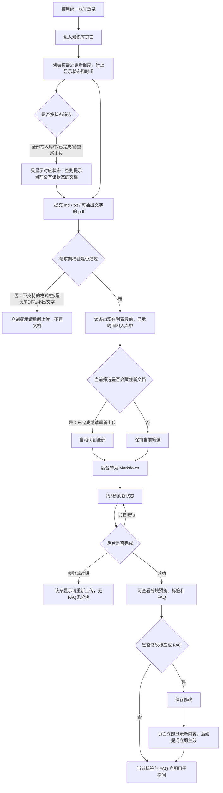
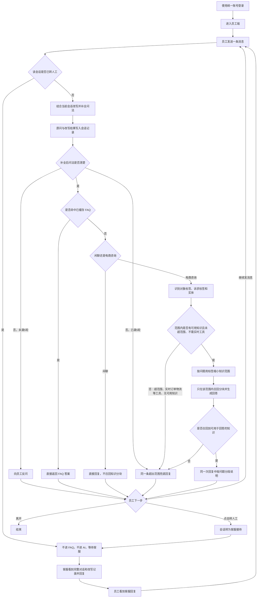
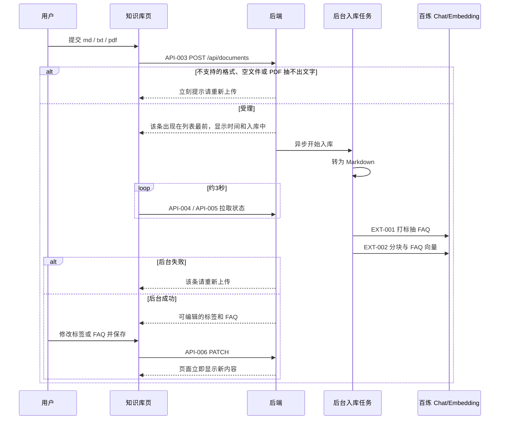
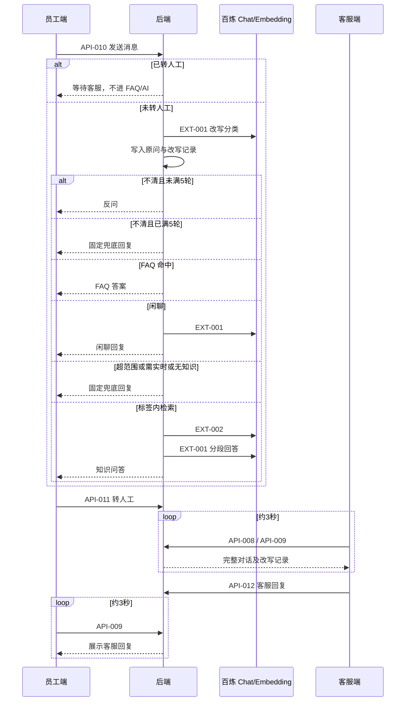
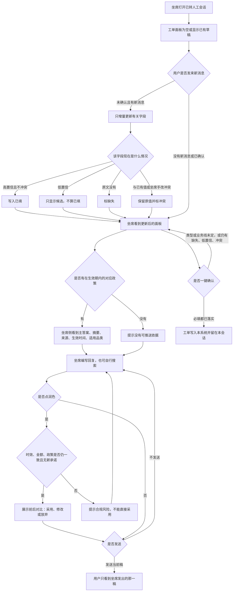
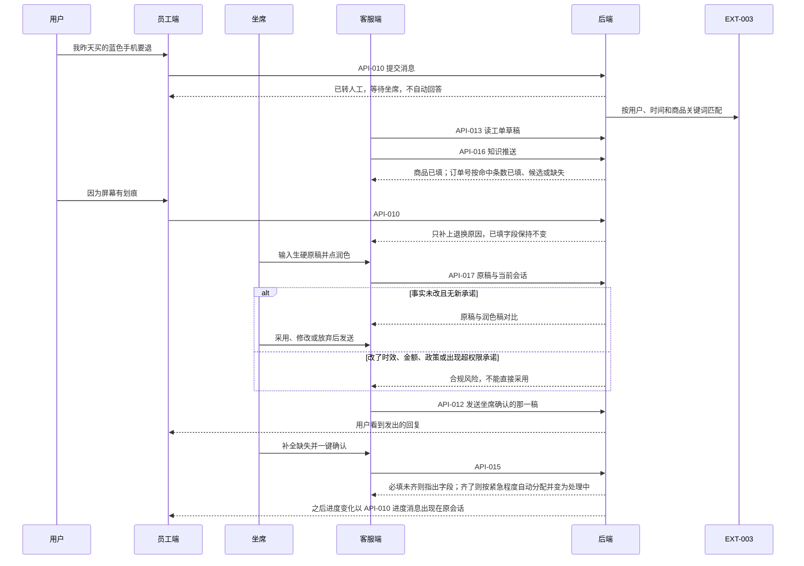
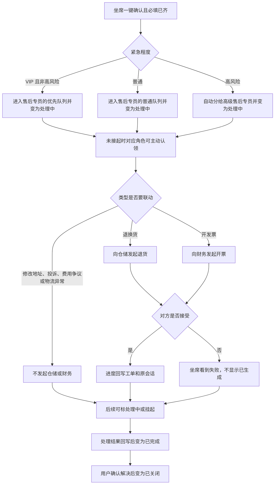

# 智能客服系统
status: Confirmed

## 用户目标与完整流程

当前没有智能客服。系统为**网页端内部使用**，**问题领域为电商板块**（售前咨询、售中说明、售后工单）。内部人员用同一套账号登录网页，在员工端代替用户提问。未转人工时按电商知识问答；转人工后员工端仍作为用户入口，坐席按电商工单处理。未转人工时，系统先结合当前会话对问法做多轮改写、补全对话，并把每次改写后的问法写入本会话记录。问法仍不清楚时向用户反问（同一问题链路最多 5 轮）；满 5 轮后意图仍不清则结束反问，给出兜底回复，不拿猜测去检索。问法清楚后，先用已缓存的 FAQ 拦截能直接命中的问题；命中不了再判断是闲聊还是电商咨询。闲聊直接回复。电商咨询先按标签体系识别对象和诉求，只在匹配标签的知识范围内检索分块，再生成回答。超出电商知识范围、查询实时物流轨迹、库存或支付是否成功，以及范围内召不回可用知识时，用户看到同一条固定兜底回复：「抱歉，这个问题我暂时无法根据现有知识准确回答。你可以换个说法再问，或点击转人工。」未转人工不创建、不确认工单。用户询问本系统里已经存在的工单进度时，系统按该工单的最新状态直接回答，不编造进度。知识来自知识库页面灌入的文档（Markdown、TXT，以及能抽出文字的 PDF）：提交后先显示「入库中」，后台先把文件转成 Markdown，再按 Markdown 分块、按标签体系打标、写入向量库并抽出 FAQ；完成后可查看和修改标签与 FAQ，修改立即对后续提问生效。提交时不支持的格式、空文件、抽不出文字的 PDF（扫描件、纯图片）立刻提示「请重新上传」；后台失败后该条也提示「请重新上传」。完成前该文档不能改、也不能被提问命中。一条消息里多个独立问题，在同一次回复中分段说明。员工若对回答不满意，自己点「转人工」。转接后客服能看到该员工与系统的完整对话（含历次改写记录）并接管：之后员工再发的任何问题都不再进入 FAQ / AI，只等待客服回复。员工、坐席和管理端看到的页面和知识不同。坐席不能修改核心提示模板。

标签体系原文见 [tag-taxonomy.json](./tag-taxonomy.json)。对象标签与诉求标签同时用于知识入库标注和提问识别；实体记录用户或文档里出现的具体名称，不预先穷举。不使用长期用户画像，也不使用跨会话记忆，只使用当前会话里已提供的信息。

**角色**

- 员工端：提出问题；可能先看到反问、FAQ、闲聊、用户可见知识的回答、工单进度或兜底；需要时自己点转人工，之后看客服回复。询问已有工单进度时，系统直接回答。
- 一线坐席：查看已转人工会话并回复，增量填单并确认。可看完整处理步骤，可对当次结果提交反馈，可改即将发出的回复，不能改核心提示模板。可以把紧急程度往上调；把高风险往下调必须等主管同意。
- 售后专员：独立于一线坐席。确认后的普通工单默认分配给售后专员处理，也可以主动认领还没接起的工单。
- 高级售后专员：高风险工单只分配给这一角色。费用争议超时也升级到高级售后专员。
- 主管：修改地址和开发票超时后收到升级，并审批高风险降级。升级必须落到该角色的在岗人员，不能变成无人认领。
- 售后主管：退换货超时后收到升级。
- 客服负责人：投诉维权超时后收到升级。
- 物流售后专员或高级客服：VIP 物流异常到达处理时限时的一级升级对象。
- 客服主管或售后负责人：VIP 物流异常的二级升级对象。涉及赔付、用户威胁投诉或曝光、用户拒绝一级方案、一级处理人表示无法处理、或距离 VIP 时限已不足 2 小时时，立即升级到这里。其余不涉及赔付的情况，一级后再等 2 小时仍未完成再升级。二级不是无人认领。
- 管理端：维护知识可见范围，配置提示模板，配置打标规则，查看工单列表。一线坐席打不开这些配置。
- 知识库：文档仍上传到同一套底座。每篇完成后标明「用户可见 / 仅坐席可见 / 高风险仅人工」，以及政策生效时间。用户侧回答只使用「用户可见」。

**目标主流程**

1. 使用统一账号登录。
2. 在知识库页面上传 Markdown、TXT 或能抽出文字的 PDF：提交后该条立刻出现在列表最前，显示时间和「入库中」，可离开再回来。列表默认「全部」，也可按入库状态单选筛选。后台先把文件转成 Markdown，再按 Markdown 分块、按标签体系打标、写入向量库并抽取 FAQ。提交时不支持的格式、空文件、抽不出文字的 PDF 立刻提示「请重新上传」；后台失败后该条也提示「请重新上传」。仅入库完成后可查看、修改该文档的标签和 FAQ，修改立即生效。完成前该文档不能改，提问也用不上。
3. 在员工端发送一条消息。
4. 若会话已转人工：消息不进入 FAQ，也不进入 AI，等待客服。
5. 若会话未转人工：
   1. 结合当前会话对这条问法做改写，补全指代和上文已经说过的信息（多轮对话持续改写），并将原问与改写后的问法写入本会话记录，员工端与客服端查看该会话时都能看到。
   2. 改写后问法仍不清楚、会改变检索方向或回答内容时：若该问题链路的不清轮次未满 5 轮，向员工反问，不进入 FAQ/知识检索，也不走兜底；已满 5 轮后意图仍不清，结束反问并给出兜底回复。
   3. 问法已可处理时，先走 FAQ 拦截；命中已缓存问题则直接返回对应 FAQ 答案。
   4. 未命中 FAQ 时，识别该条消息：闲聊则直接回复，不进入知识检索。
   5. 属于电商咨询时，先判断补全后的问题有哪些对象/诉求标签。若超出电商知识范围、需要查实时订单/物流/库存/支付等工具，或范围内召不回可用知识：给出同一条兜底回复，不调工具、不建工单。否则用标签缩小知识范围，只在该范围内召回分块并生成回答。一条消息里有多个可独立处理的问题时，在同一次回复中按问题分段说明。
6. 员工若要人工，自己点转人工（系统不设立「转人工」的 AI 意图，也不会因为话里出现相关字样而自动转接）。
7. 转接后客服看到此前完整对话（含改写记录）并接管；该会话内员工再发的内容只等待客服回复。
8. 客服写出回复，员工在同一条对话里看到客服回复。
9. **转人工后（电商工单）**：员工端仍作为用户入口。坐席打开会话时工单面板先按已有草稿显示；没有草稿则为空。用户每说一条新消息，系统只增量更新有变化的字段，不整张工单重做。高置信且不冲突的值写入字段；低置信只显示候选；原文没有的标缺失；与已有值冲突时保留原值并标出，由坐席选择。坐席可改单个字段，也可在必填完整后一键确认。确认后的工单只写在本系统，并留在本会话里。售前不建销售单。售后四类仍是退换货、修改地址、开发票、投诉维权。业务线仍由坐席手选并可改。知识只推给坐席，一条结果要有主答案、摘要、来源、生效时间和适用品类。润色只改说法，并给出前后对比；坐席采用、修改或放弃后，才决定发不发。填单、检索和润色按当前业务线、工单类型、售前或售后选用对应模板。

调研依据（公开资料，2026-09-22；竞品能力不自动等于本项目范围）：华为云客服「智能填单」从对话提取工单类型与字段、由坐席创建工单（[华为云用户指南](https://support.huaweicloud.com/intl/zh-cn/usermanual-cec/cec_04_0562.html)）；京东科技坐席辅助含知识提示与工单实体提取、支持手动修改（[云巴巴产品介绍，仅搜索摘要](https://www.yun88.com/product/11355.html)）；售后工单常见字段含订单号、售后类型/原因、金额、备注等（[积加 ERP 售后工单说明](https://help.jijiaerp.com/docs/FZcUTnO4)）。本轮采用「AI 预填 + 坐席确认」，不采用对话结束自动建单、不对接外部电商中台。

## 本次范围

**本次交付**

- 登录后按身份进入被允许的页面。员工端、坐席、管理端的可见范围不同。
- 知识入库：支持 Markdown（`.md`）、TXT（`.txt`）和能抽出文字的 PDF（`.pdf`）；提交后后台先转为 Markdown，再按 Markdown 分块、打标、写入向量库、抽 FAQ（页面先显示「入库中」）；知识库列表按最近更新时间倒序，每行显示时间与入库状态，并可用「全部 / 入库中 / 已完成 / 请重新上传」筛选；完成后可查看/修改标签和 FAQ，修改后实时对提问生效。提交校验失败或后台失败均提示「请重新上传」。扫描件、纯图片 PDF 本轮不做文字识别。
- 未转人工时的回答链路：当前会话内多轮改写补全问法并写入会话记录 → 仍不清楚则反问（最多 5 轮，满 5 轮仍不清则兜底）→ 清楚后 FAQ 拦截 → 闲聊直接回复，或电商咨询只在「用户可见」且标签匹配的知识里回答。询问本系统已有工单进度时直接按工单状态回答。物流异常要对照物流轨迹和签收状态，不能只复述用户的说法。单纯查「现在到哪了」、库存或支付是否成功，以及没有可用知识时走兜底。未转人工不建工单。
- 员工触发转人工，以及转人工后客服接管并主动回复（客服可见转接前完整对话及改写记录；转接后员工消息不再进 FAQ / AI）。
- **客服与管理端（2026-09-23 草稿）**：转人工后增量填单。订单号来自订单中心：一条自动填，多条只列候选，零条标缺失。工单类型含费用争议和物流异常。确认后默认自动分配给售后专员，高风险只给高级售后专员，也允许主动认领。按类型分处理时限，先预警再关闭；VIP 超时只升级、不自动关闭。退货联动仓储，开票联动财务。知识底座一套、内容分三级。管理端配置模板的版本、灰度、回滚和评测。

**非目标（本次不做，除非后续明确要求）**

- AI 识别「转人工」意图或自动转接。
- 客服主动发起一条新的员工对话。
- 把其他会话的闲聊当成当前回答的上下文。紧急程度打标可以使用会员等级、历史消费、历史投诉和退款记录。
- 未转人工时创建工单，或在普通问答里查询库存、支付是否成功、以及与物流异常无关的实时位置。问法不清楚时先反问，同一问题链路最多 5 轮；满 5 轮后仍意图不清则改走兜底。已有工单进度、以及物流异常所需要的轨迹和签收状态，不在此列。
- 对话结束自动建单、不经坐席确认的工单提交。低置信候选和未解决的冲突不能靠一键确认被静默接受。
- 润色结果不经坐席确认直接发给用户。润色不得改时效、金额、政策等事实，也不得新增赔付、改价或「一定退」类承诺。
- 在订单中心返回多条匹配时自动挑一笔订单。查不到订单时编造订单号。
- 把已过期或未填写生效时间的政策当作当前依据。把「仅坐席可见」或「高风险仅人工」的内容用作未转人工的自动回答。
- 电话/语音渠道、全量质检。高风险工单由一线坐席降级后不经主管就生效。AI 自动承诺赔付金额。
- 未提出的历史会话列表（员工侧）、评价、下载导出等能力。客服端为处理已转人工会话所必需的会话查看不在此列。
- Word、Excel、图片等上述三种以外的文档格式；扫描件/纯图片 PDF 的 OCR 识别；整篇文档的删除或替换（本次只改标签和 FAQ，不另做整篇删改）。
- 把知识推送区的标准答案自动当作发给用户的消息。
- 售前建销售单、下单或改价。坐席修改核心提示模板。没有评测集时把新模板灰度放量。

**约束**

- **网页端内部使用**；**问题领域为电商板块**。未转人工按电商知识问答（REQ-001），不建工单。**转人工后按电商工单**处理，员工端仍作为用户入口。
- 知识文档支持 Markdown、TXT，以及能抽出文字的 PDF；不支持扫描件 OCR。
- 对象与诉求标签同时用于入库标注和提问识别；检索不得对全部知识分块无差别召回。
- 转人工只由员工在界面上触发。
- 当前回答只用当前会话上下文。紧急程度可以引用会员等级、历史消费金额、订单价值和历史投诉次数。
- 本轮工单、知识推送与话术润色出现在已转人工的客服端。未转人工不自动建单。物流异常的回答要能查看轨迹和签收状态。
- 工单类型：退换货、修改地址、开发票、投诉维权、费用争议、物流异常。未形成其中一类不能确认工单。业务线仍是 3C 数码、服饰美妆，由一线坐席手选并可在确认前修改。物流异常的类型为延迟、丢件、破损、错发/漏发、拒收、地址异常。地址异常不是「修改地址」工单。
- 确认后工单先为待处理，并默认自动分配。普通工单分给售后专员，高风险只分给高级售后专员；分配成功后变为处理中。尚未接起的工单可以由对应角色主动认领。退货联动仓储，开票联动财务，进度回写原会话。
- 普通用户：修改地址和开发票 2 小时，时限前 30 分钟预警，超时升级主管，预警后再过 24 小时才可关闭。退换货 24 小时，时限前 4 小时预警，超时升级售后主管，预警后再过 48 小时才可关闭。费用争议 24 小时，时限前 4 小时预警，超时升级高级售后专员，预警后再过 48 小时才可关闭。投诉维权 48 小时，时限前 8 小时预警，超时升级客服负责人，预警后再过 72 小时才可关闭。物流延迟、错发/漏发、拒收为 24 小时，时限前 4 小时预警，预警后再过 24 小时才可关闭。丢件、破损为 48 小时，时限前 12 小时预警，预警后再过 48 小时才可关闭。地址异常为 12 小时，时限前 2 小时预警，预警后再过 12 小时才可关闭。
- VIP 不自动关闭。到处理时限只升级，不关闭。修改地址和开发票的处理时限是 30 分钟，时限前 10 分钟预警。退换货的处理时限是 4 小时，时限前 1 小时预警。费用争议的处理时限是 2 小时，时限前 30 分钟预警。投诉维权的处理时限是 4 小时，时限前 1 小时预警。升级必须落到在岗的人：修改地址和开发票给主管，退换货给售后主管，费用争议给高级售后专员，投诉维权给客服负责人。没有在岗的人时，工单仍挂在该角色下并标明升级未送达，不能变成无人认领。VIP 单独排队，优先于普通工单分配。VIP 物流异常也不自动关闭。延迟、错发/漏发、拒收的 VIP 处理时限是 12 小时，时限前 3 小时预警。丢件、破损的 VIP 处理时限是 24 小时，时限前 8 小时预警。地址异常的 VIP 处理时限是 6 小时，时限前 1.5 小时预警。到达该时限时，一级升级给在岗的物流售后专员或高级客服。工单里已经有赔付或补偿方案时，同时升到在岗的客服主管或售后负责人。不涉及赔付时，一级升级后再等 2 小时，仍未完成就升到二级。会话里已经出现威胁投诉、曝光或找消协，用户明确不接受一级给出的方案，一级处理人表示权限不够或需要主管审批，或者距离 VIP 处理时限已不足 2 小时，这四种情况不等这 2 小时，立即升到二级。普通工单自动关闭前必须已告知用户；用户随后又说话，或仍在等补充，则不关闭。
- 订单号来自订单中心：用当前用户、原话中的时间范围和商品关键词做模糊匹配。只命中一条时自动填入；命中多条时只列出候选；零条时标缺失。金额、税号、电话、地址仍只来自会话原文或坐席手填，不编造。高置信且与已有值不冲突才写入；低置信只显示候选；缺失保持空。未确认草稿里，新消息与已有值冲突时保留原值并标冲突。坐席已经改过的字段不被后续抽取覆盖。工单确认之后，新消息不再自动改字段；坐席仍可手改除工单类型以外的内容。

## 需求与验收

### REQ-001 未转人工时的提问回答（FAQ、闲聊、标签检索）
- 用户结果与主流程：已登录用户在员工端发消息，且会话未转人工时，系统先结合当前会话改写、补全这条问法，并把原问与改写结果写入本会话记录。问法不清楚且该问题链路未满 5 轮时员工看到反问；已满 5 轮仍意图不清则看到兜底回复。问法清楚后按下列顺序处理：先 FAQ 拦截；未命中再区分闲聊与电商咨询；闲聊直接回复；电商咨询先识别标签，仅在匹配标签的知识范围内召回分块后再回答。超出电商知识范围、查询实时订单/物流/库存/支付等工具场景，以及范围内没有可用知识时，员工看到同一条超出范围兜底回复。未转人工不创建工单。一条消息含多个可独立处理的问题时，同一次回复按问题分段说明。
- 业务规则、权限、数据归属与状态（适用时）：
  - 未转人工会话才走本链路；已转人工见 REQ-003。
  - 每条员工消息都先按当前会话做问法改写与补全（多轮持续使用上文，不使用其他会话）。改写用于后续 FAQ 拦截、标签识别和检索。原问与改写后的问法必须写入本会话记录，员工端和客服端查看该会话时都能看到，不能只用完即丢。
  - 一轮不清 = 员工一条消息经改写后仍无法确定意图、系统因此给出反问。同一问题链路最多 5 轮反问：第 1 至第 5 轮意图不清时反问；第 5 轮之后员工再发仍意图不清，结束反问并给出兜底原文，不再反问。5 轮内一旦说清，立即进入 FAQ 或知识回答。
  - 改写后仍不清楚、缺失信息会改变检索方向或回答内容，且未满 5 轮时：向员工反问，等待下一轮消息再改写；不猜测补全后直接检索，不自动转人工。
  - FAQ 命中后不再做知识分块召回，也不再当闲聊处理。FAQ 匹配使用补全后的问法。
  - 闲聊（`small_talk`）直接回复，不进入知识库召回。
  - 电商咨询（`service_request`）必须先识别对象标签、诉求标签和明确提到的实体，再按标签缩小召回范围；不能对全部知识分块做无差别召回。
  - 标签取值与分类规则以 [tag-taxonomy.json](./tag-taxonomy.json) 为准。实体不是预置标签。不因出现商品名就直接判定诉求（例如提到某款手机不等于要退货）。不把现象当成原因。3C 与服饰美妆口径不得混用。
  - 同一个问题选一个主要诉求；一条消息里多个可独立处理的问题拆开，在同一次系统回复中按问题分段说明，不拆成多条独立会话消息。
  - 分类不完全确定但已够做有意义检索时，先检索，不为分类本身反复反问。
  - `needs_clarification`（问法不清楚）在未满 5 轮时对员工表现为反问；满 5 轮后仍不清则与 `requires_live_data`、`out_of_scope` 以及范围内召不回可用知识一样，对员工表现为同一条固定兜底回复。不调用工单或其他工具、不编造实时状态、不拿无关知识硬答、不自动转人工。
  - 兜底回复固定为：「抱歉，这个问题我暂时无法根据现有知识准确回答。你可以换个说法再问，或点击转人工。」
- 业务前置条件：用户已登录；该会话尚未转人工。
- AC-001：已登录、知识库已有对应标签的知识、会话未转人工、补全后的问题不能被 FAQ 命中且属于电商咨询 → 员工提交该问题 → 员工看到基于匹配标签范围内知识的回答，且未进入等待客服状态；验证方式：灌入带明确对象/诉求的电商文档后，提一个应命中该范围的问题。
- AC-002：会话未转人工，FAQ 未命中 → 无论随后是反问、闲聊、知识回答还是兜底回复，系统都不自动转人工；员工仍可自己点转人工；验证方式：空库、无关问题、不清楚的问法或闲聊各试一次，确认未自动转接。
- AC-011：知识入库时已抽出并可缓存的 FAQ 问题 → 员工提交与该 FAQ 对应的问题（含需结合上文才能对齐 FAQ 的简短追问）→ 员工看到 FAQ 缓存答案；该次不进入闲聊，也不进入标签范围内的分块召回问答；验证方式：用入库抽出的 FAQ 原问，以及一则依赖上文的简短问法各测一次。
- AC-012：会话未转人工，消息为闲聊且不能被 FAQ 命中 → 员工提交该消息 → 员工看到一条直接回复，答案不依赖知识库分块；验证方式：发送问候或与购物咨询无关的闲聊。
- AC-013：存在至少两类不同对象标签的知识分块 → 员工提一个只属于其中一类对象的电商问题（FAQ 未命中）→ 回答所依据的知识应来自标签匹配后的范围，而不是把另一类对象的知识当作依据；验证方式：分别灌入 3C 商品文档与服饰退换货政策文档，只问其中一类。
- AC-014：超出电商知识范围、只问包裹现在到哪、询问库存或支付是否成功，或用户可见范围内没有可用知识 → 员工看到固定文案「抱歉，这个问题我暂时无法根据现有知识准确回答。你可以换个说法再问，或点击转人工。」看不到编造的位置或支付结果；系统不自动转人工、不建工单；验证方式：上述情形各举一例，回复原文一致。已有工单进度见 AC-075，物流异常的轨迹核对见 AC-085。
- AC-015：出现 AC-014 的情形时 → 系统不编造实时物流、库存或支付状态；验证方式：与 AC-014 同一批例子，确认没有这类结果。
- AC-016：一条消息包含至少两个可独立处理的电商问题，且均可检索回答 → 员工看到同一次回复中按问题分段说明，而不是多条独立系统消息；验证方式：一次发送两个不同对象的问题（例如一件 3C 商品规格和一条服饰退货时限）。
- AC-019：当前问法不清楚（例如只说“能不能退”，且当前会话也补全不出商品或订单），且该问题链路未满 5 轮 → 员工看到反问，而不是兜底原文，也不是猜测后的知识回答；该轮的原问与改写结果出现在本会话记录中；验证方式：新会话发送含糊问法，并核对话记录。
- AC-020：系统已反问后，员工在同一会话、5 轮内补充了关键信息 → 系统用补全后的问法继续 FAQ 或知识回答，而不是忽略上文；验证方式：先发含糊问法，再按反问补全后对照是否进入可检索回答或 FAQ。
- AC-021：同一会话中员工用简短指代追问（例如上一轮在谈某款连衣裙，本轮只说“能退吗”）→ 系统按补全后的该商品退货问题处理，而不是当成全新的、无对象的问题直接兜底；改写结果写入会话记录；验证方式：先问服饰相关问题，再发简短追问并核对话记录。
- AC-022：同一问题链路已连续 5 轮因意图不清而反问 → 员工再发送一条仍无法确定意图的消息 → 员工看到兜底原文，不再看到第 6 次反问；验证方式：连续 6 次含糊表述，第 1–5 次为反问，第 6 次为兜底。

### REQ-002 知识文档入库、查看分块预览与实时改标签/FAQ
- 用户结果与主流程：已登录用户在知识库页面提交 Markdown（`.md`）、TXT（`.txt`）或能抽出文字的 PDF（`.pdf`）后，该条立刻出现在文档列表最前，显示时间和「入库中」，并可离开。列表按最近更新时间倒序；每行可见文件名、入库状态和时间。用户可用单选筛选「全部 / 入库中 / 已完成 / 请重新上传」只看对应状态。后台先把该文件转成 Markdown（`.md` 原文即 Markdown；`.txt` 转为 Markdown 正文；`.pdf` 抽出可复制文字后再转为 Markdown），再按同一套 Markdown 规则分块（按标题与段落切，单块不超过 800 字、块间重叠为单块上限的 20% 即 160 字、保留标题路径；转成的 Markdown 没有标题时标题路径为空），然后打标、写入向量库、抽取 FAQ。仅当入库完成（`ready`）后，页面可查看：① 实际切出的全部分块预览（序号、标题路径、正文，只读）；② 标签和 FAQ（可修改）。修改标签/FAQ 保存后立即生效。完成前该文档不能看分块、不能改标签/FAQ，也不能被提问命中。
- 业务规则、权限、数据归属与状态（适用时）：
  - 知识底座只有一套。入库完成后，每篇文档必须标明可见范围：用户可见、仅坐席可见、高风险仅人工。未转人工的自动回答只召回「用户可见」。坐席推送和搜索可以召回这三类。坐席看到完整处理步骤；自动回答给用户的内容只用对客话术，不把内部步骤发给用户。
  - 本次支持 Markdown（`.md`）、TXT（`.txt`）和能抽出文字的 PDF（`.pdf`）。提交时其他扩展名、空文件、损坏文件、抽不出可用正文的 PDF（扫描件、纯图片、加密无法打开）立刻提示「请重新上传」，列表不出现该文件。本轮不对扫描件做 OCR。后台入库失败或过期后，该条显示「请重新上传」；失败文档不会变成可拦截的 FAQ，也不会进入可召回的知识分块。
  - 知识库列表始终按最近更新时间倒序（最新在最上）。每行展示文件名、入库状态（入库中 / 已完成 / 请重新上传）和时间。筛选为单选，四个选项：全部、入库中、已完成、请重新上传；默认「全部」。筛选只改变列表里能看见哪些行，不删除文档。当前筛选下没有文档时，列表提示「当前没有该状态的文档」，上传条仍可用。
  - 上传成功后，若当前筛选会把这篇新文档藏掉（新文档为「入库中」，而筛选是「已完成」或「请重新上传」），则自动切到「全部」，让用户立刻在最前看到该条。筛选已是「全部」或「入库中」时保持不变。
  - 每个成功入库的文档都要真正执行分块并落库，不能只计数不切文。无论原始是 `.md`、`.txt` 还是 `.pdf`，分块都只针对转换后的 Markdown。分块策略对用户可见：按 Markdown 标题与段落切块，单块不超过 800 字，块间重叠为单块上限的 20%（800 字时为 160 字，落在常用的 10%～30%），有标题时保留标题路径前缀；转换后没有标题时标题路径为空，不冒充标题。列表仍显示用户上传时的原文件名。
  - 分块预览只读，页面上不能改分块正文。改标签会作用于后续召回过滤，不重新切块。
  - 每个文档都要抽取 FAQ；抽出的 FAQ 用于提问时的先行拦截。
  - 标签和 FAQ 仅在入库完成后可查看、修改；修改后实时更新。本次不要求整篇文档删除或替换上传。
  - 入库完成后可以填写政策生效的开始时间和结束时间。适用品类沿用已有对象标签，不另建分类。没填生效时间的文档，不能被坐席当作当前政策推送（见 AC-048）。
- 业务前置条件：用户已登录；上传时已有 Markdown、TXT 或能抽出文字的 PDF 知识文档。
- AC-003：已登录并进入知识库页面，提交一篇可用的 Markdown、TXT 或能抽出文字的 PDF 且后台入库完成 → 该文档已分块、已打标并进入向量库，且已抽出 FAQ；页面能看到该文档的标签和 FAQ 并允许修改；随后用文档中的 FAQ 提问能被拦截，用文档中的非 FAQ、但属于其标签范围的问题能检索到该文档分块并回答；验证方式：至少用 Markdown 完成一次全链路；TXT 与可抽出文字的 PDF 各至少完成一次入库到可查看标签/FAQ。
- AC-004：提交不支持的格式（非 `.md` / `.txt` / `.pdf`），或空文件，或抽不出可用正文的 PDF（扫描件、纯图片），或后台入库失败 → 页面提示「请重新上传」；该文件不会变成可拦截的 FAQ，也不会进入可召回的知识分块；校验失败时列表不出现该文件。验证方式：上传非这三种扩展名的文件、一篇抽不出文字的 PDF，以及一次导致入库失败的情况（若可构造）。
- AC-017：入库完成后在知识库页面修改某文档的标签并保存 → 页面立即显示新标签；随后员工提一个只匹配新标签、不再匹配旧标签的问题（FAQ 未命中）→ 召回范围按新标签生效；验证方式：改标签后立刻提问对照。
- AC-018：入库完成后在知识库页面修改某条 FAQ 的问法或答案并保存 → 页面立即显示新 FAQ；随后员工按新问法提问能命中新答案，按已删除或已改掉的旧问法不再命中旧答案；验证方式：改 FAQ 后立刻提问对照。
- AC-023：提交一篇可通过校验的 Markdown、TXT 或能抽出文字的 PDF 后、后台尚未完成 → 页面立刻显示「入库中」，可离开再回来仍能看到该条进行中；此时不能查看分块预览，也不能改该文档标签/FAQ；员工提问不会命中这篇尚未完成的文档；验证方式：上传后在完成前立即查看列表并尝试提问、尝试编辑。
- AC-024：入库完成后打开该文档 → 页面展示分块策略说明，以及按该策略实际切出的全部分块（至少能看到序号和每块正文；有标题时能看到标题路径），块数与入库结果一致，且不是整篇原文只显示为 1 块（除非原文确实短于一块上限）；分块正文只读，没有保存分块的入口；验证方式：上传一篇含多个二级标题、总长度明显超过 800 字的 Markdown，完成后核对预览块数与内容来自原文。
- AC-029：提交一篇总长度明显超过 800 字的 TXT，以及一篇能抽出大段文字的 PDF，且入库完成 → 两者都先转为 Markdown 再按同一套 Markdown 分块规则入库；页面能看到多块（除非转换后的正文短于一块上限），标题路径仅在转换后的 Markdown 确有标题时出现，否则为空不冒充标题；分块正文来自转换后的 Markdown 且只读。验证方式：各测一篇 TXT 与一篇可抽出文字的 PDF，确认走的是转 Markdown 后的分块，而不是跳过转换。
- AC-027：已登录并进入知识库，列表中已有至少两篇更新时间不同的文档 → 打开知识库或再上传一篇可通过校验的文档 → 列表按最近更新时间倒序，最新在最上；每行能看到文件名、入库状态和时间；新上传的那条在最前且状态为「入库中」；验证方式：对照已有文档的时间顺序，再上传一篇并确认它出现在最前、带时间和「入库中」。
- AC-028：已登录，列表中能区分到不同入库状态（至少用已有文档或上传构造）→ 分别选择「全部 / 入库中 / 已完成 / 请重新上传」→ 「全部」显示所有文档且仍按最近更新倒序；其余三项只显示对应状态；某项一个都没有时出现「当前没有该状态的文档」，上传仍可用。当前筛选为「已完成」或「请重新上传」时再上传一篇成功的文档 → 筛选自动变为「全部」，新文档在最前且为「入库中」。验证方式：逐个点四个筛选，再在非「入库中/全部」筛选下上传一篇对照。
- AC-053：入库已完成的文档 → 填写生效开始和结束时间并保存 → 再次打开仍显示这两个时间；清空后保存，再次打开为空。验证方式：保存、离开、再打开各做一次。
- AC-059：入库完成后把一篇文档标为「仅坐席可见」并保存 → 未转人工的员工提问不能用这篇文档回答；已转人工的坐席推送或搜索可以看见它。把另一篇标为「用户可见」 → 未转人工的对应问题可以答出对客话术，回答里不出现仅坐席可见文档中的内部步骤。验证方式：两篇文档各问一次，对照员工端和坐席端。
- AC-060：文档标为「高风险仅人工」 → 未转人工的自动回答不使用它；坐席侧可以打开并看到完整内容，该内容不会自动发给用户。验证方式：员工端提问与坐席端推送各看一次。

### REQ-003 员工触发转人工，客服接管并回复
- 用户结果与主流程：员工在对话中自己点转人工。转接后客服在客服端看到该会话，以及转接前员工与系统的完整对话（含 FAQ、闲聊、知识问答、反问，以及历次原问与改写记录），并接管回复。此后该会话内员工再发的任何问题都不再进入 FAQ 拦截，也不进入 AI，而是等待客服响应；客服发出的回复出现在员工同一条对话中。
- 业务规则、权限、数据归属与状态（适用时）：
  - 转人工只由员工触发；系统不设立转人工的 AI 意图，AI 不得因识别到相关说法而自动转接。
  - 会话一旦转人工，状态变为「客服接待」，FAQ 与 AI 都不再接收该会话的新问题。
  - 客服回复由客服确认后发出。本轮可对拟发送内容做润色（REQ-007），但 AI 不得绕过坐席直接发给用户。
  - 客服只处理已转人工的会话，不主动向员工发起新会话。
  - 不做多客服抢接或按人分单：同一登录进入客服端即可查看并回复已转人工会话。
- 业务前置条件：用户已登录；存在一条员工已点转人工的会话。
- AC-005：员工已点转人工 → 客服端打开该会话，能看到转接前员工与系统的完整对话及改写记录，并发送一条回复 → 员工在同一条对话中看到该客服回复；验证方式：转人工后由客服发一条可见回复，并核对话记录中含改写结果。
- AC-006：会话已转人工 → 员工再发送新问题（即使是已缓存 FAQ 或闲聊，且不是在问已有工单进度）→ 该问题不进入 FAQ、也不进入 AI，会话保持等待客服响应，直至客服回复；验证方式：转人工后再问一句 FAQ 和一句新问题，确认都没有系统自动回复。询问已有工单进度的例外见 AC-075。
- AC-007：会话未转人工 → 员工即使提到“转人工”等字样，只要未点转人工按钮，新问题仍走 REQ-001 链路；客服端不按已接管会话来处理它；验证方式：不点按钮，仅用文字说转人工，确认仍由系统自动回复。
- AC-008：会话未转人工 → 不出现“等待客服响应”的接管结果；验证方式：未转接会话在客服端不可按已接管会话回复，或回复不能替代 FAQ/AI 成为该会话的接待方。

### REQ-004 按身份登录、已登录状态与退出
- 用户结果与主流程：员工、坐席、管理端使用各自被允许的身份登录。员工进入员工端；坐席进入客服端；管理端进入知识库、模板配置和工单列表。登录后顶栏能看到当前用户名，并可以点「退出」。退出后回到登录页，未再次登录前不能使用业务页。坐席打不开模板配置和灰度发布。
- 业务规则、权限、数据归属与状态（适用时）：未登录只能停留在登录页。退出后直接访问业务页会回到登录页。身份不对的页面不能使用其中的能力。
- 业务前置条件：无。
- AC-009：使用员工身份的正确账号登录 → 能进入员工端并看到用户名；使用坐席身份能进入客服端；使用管理身份能进入知识库。验证方式：三种身份各登录一次，确认进入的是被允许的页面。
- AC-061：使用坐席身份打开模板配置或工单管理中的灰度发布 → 不能修改模板，也不能发布；使用管理身份可以打开模板配置。验证方式：两种身份各打开一次配置入口。
- AC-010：用户名或密码错误 → 不能进入上述页面的业务能力，并看到登录失败说明；验证方式：用错误密码尝试登录。
- AC-025：已登录 → 顶栏显示「已登录」及该用户名，并提供「退出」；验证方式：登录后在员工端、客服端、知识库各看一次顶栏。
- AC-026：已登录时点「退出」→ 回到登录页（可见未登录）；再打开员工端/客服端/知识库会被要求先登录，不能继续使用业务能力；验证方式：退出后直接打开员工端地址，应回到登录。

### REQ-005 转人工后按标准工单智能填单并确认
- 用户结果与主流程：会话已转人工后，坐席在右侧工单面板看到按工单类型组织的表单。打开时若还没有草稿，面板为空。之后每条用户消息只增量更新有关字段，不把整张工单重新生成一遍。高置信且不与已有值冲突的内容写入字段；低置信的内容只出现在字段旁作候选；会话里没提到的必填项标为缺失；新内容与已有值冲突时保留原值并标出冲突，由坐席选择。坐席可以改某一个字段，也可以在必填都已落实后一键确认。确认后再次打开，看到的是确认时的内容。
- 业务规则、权限、数据归属与状态（适用时）：
  - 仅已转人工会话展示填单区。未转人工不建工单草稿。
  - 工单类型：退换货、修改地址、开发票、投诉维权、费用争议、物流异常。当前会话意图清楚时，可以预填其中一类；意图不够清楚时不锁定类型。未形成这几类之一时，不能确认工单，不建销售单。
  - 业务线：3C 数码、服饰美妆。**由一线坐席手选，并可在确认前修改**；系统不自动指定业务线。未选业务线时，抽取与知识推送不按某一边口径锁定。确认时业务线必须已手选。物流异常不是第三种业务线，3C 和服饰的订单都可以走这类工单。
  - 字段状态只有四类，坐席必须能区分：**已填**（高置信或坐席已认可）、**低置信候选**（可见但未写入）、**缺失**、**冲突**（保留原值，待坐席选择）。一键确认时，低置信候选、缺失的必填项和未解决的冲突都会挡住确认，并指出是哪些字段。
  - 四类工单的**公共字段**：工单类型、业务线、订单号、商品信息（名称或规格）、相关金额、用户诉求摘要。
  - **退换货**另需：售后方式（退货 / 换货 / 仅退款）、退换原因、数量。
  - **修改地址**另需：原地址（若会话中出现）、新地址、收件人、联系电话。
  - **开发票**另需：发票种类（普通发票 / 专用发票）、抬头、纳税人识别号（专票时必填）、接收邮箱或手机。
  - **投诉维权**另需：投诉类别、事实经过摘要、用户期望、是否要求升级。
  - **费用争议**另需：争议类型（价保 / 运费 / 退款金额）、用户主张金额、平台核算金额、差异原因、证据截图。缺证据截图不能确认。回答和润色要写出核算过程，不能直接承诺赔付金额；平台核算金额只能来自已有核算结果，不能由模型新编一个数。
  - **物流异常**另需：物流单号、异常类型（延迟 / 丢件 / 破损 / 错发或漏发 / 拒收 / 地址异常）、责任方（快递 / 仓库 / 平台）、用户诉求、补偿方案。地址异常仍是物流异常，不改成修改地址工单。责任方和补偿方案必须能对照物流轨迹与签收状态；轨迹暂时查不到时，这两项保持缺失，不能只按用户的说法填上。补偿方案不能由模型自动承诺赔付。
  - 用户没说出订单号时，系统用当前用户、原话里的时间范围、商品关键词向订单中心做模糊匹配。时间范围必须来自原话，不能自行改成另一段日期。只命中一条时，订单号记为已填。命中多条时不自动填，列出候选给坐席选。零条时订单号标缺失，由坐席手填或向用户索取。订单中心暂时查不到时，订单号保持缺失并说明暂未查到，不编造单号。昨天有两笔蓝色手机订单时，必须两笔都列为候选，不能挑一笔。
  - 金额、税号、电话、地址只来自会话原文或坐席手填。
  - 坐席改过的字段，后续抽取不覆盖。新消息若与该手改值矛盾，标冲突，原手改值保留到坐席再选。
  - 确认前为草稿；确认后为已确认工单，只保存在本系统。确认之后新消息不再自动改任何字段。坐席仍可手改已确认内容，但不能改工单类型。
- 业务前置条件：用户已登录；存在已转人工会话。
- AC-030：已转人工，用户已说清订单号、商品、退货原因和金额，且这些信息互相不冲突 → 对应字段显示为已填，并能对照会话原文；坐席补上工单类型（若尚未预填）和业务线后一键确认 → 再打开仍是这些已确认值；验证方式：按脚本说完后对照面板与确认后的工单。
- AC-031：会话只提到要改地址但没有新地址 → 新地址标为缺失，不出现编造地址 → 用户后来说出完整新地址且与已有值不冲突 → 未确认草稿中的新地址变为已填，其他已填字段保持不变；验证方式：分两轮发言对照草稿。
- AC-032：未确认草稿中金额已是用户说过的 99 元，用户后来说 88 元 → 金额仍显示 99 元并标为冲突，不自动变成 88 元 → 坐席选 88 元或手改成 80 元后，草稿才变成坐席选定的值；验证方式：两轮金额对照，确认未被静默覆盖。
- AC-033：坐席未点确认 → 该会话没有已确认工单；刷新或离开再回来仍是草稿；验证方式：只预填不确认，再打开看状态。
- AC-034：未转人工的会话 → 客服端不出现可确认的工单填单区，也不能为该会话确认工单；验证方式：不点转人工，客服端不按已接管会话填单。
- AC-043：已转人工、工单类型未形成可确认的一类 → 不能确认正式工单；知识推送与话术润色仍可用，发出的回复出现在用户侧；验证方式：类型为空或仅为低置信候选时尝试确认，应不可用或失败，仍能润色并发送一条消息。
- AC-044：已转人工，用户说「我昨天买的那个蓝色手机要退」，原文没有订单号；订单中心按该用户、昨天、蓝色手机只命中一条 → 商品在识别清楚时为已填，订单号自动填入该条并标为高置信；退换原因仍为缺失。命中的订单号能对上订单中心返回的那一条。验证方式：准备一条匹配订单后对照面板。
- AC-057：同一句话，订单中心返回两笔蓝色手机订单 → 订单号不自动填入其中任何一笔，两笔都作为候选列出；坐席选定一笔后，订单号才变成已填。验证方式：准备两笔匹配订单，确认面板没有预先选中。
- AC-058：同一句话，订单中心返回零条，或暂时无法查询 → 订单号为缺失，不出现编造单号；无法查询时能看到暂未查到的说明。验证方式：空结果和查询失败各测一次。
- AC-045：承接 AC-044 的未确认草稿，用户接着说「因为屏幕有划痕」 → 「退换原因」补上该说法，商品等已经已填的字段不被清空或改写；验证方式：两轮对话对照同一张草稿。
- AC-046：坐席把商品手改为「黑色手机」后，用户又说「是蓝色的」 → 商品仍保持「黑色手机」并标冲突，不自动改回蓝色；坐席选定后才变化；验证方式：先手改再发矛盾消息。
- AC-047：工单已确认后，用户又补充新的原因或金额 → 已确认字段不自动变化；坐席仍可手改除工单类型以外的内容；尝试把工单类型改成另一类时不被接受；验证方式：确认后再发一条消息，并尝试改类型。
- AC-083：费用争议草稿里订单号、商品、争议类型、用户主张金额、平台核算金额和差异原因都已有，但没有证据截图 → 不能确认。补上截图后才能确认。润色或回答里不出现模型新编的赔付金额，要能看到主张金额、核算金额和差异原因。验证方式：缺图时点确认，补图后再确认，并检查回复。
- AC-085：用户说快递丢了，物流轨迹显示已签收 → 回答或工单说明里同时写明用户说法和已签收，不把丢件当成已确定事实，也不据此自动填责任方。轨迹暂时查不到 → 责任方和补偿方案为缺失，回复说明暂时不能判断，不编造责任方。验证方式：已签收和查不到轨迹各测一次。

### REQ-006 按当前会话为坐席推送知识
- 用户结果与主流程：已转人工后，坐席在侧边看到与当前意图、会话关键词、已选业务线和工单类型最相关的政策、流程和话术。每条结果先给出一条主答案和短摘要，并显示来源、生效时间、适用品类；坐席可以点开详情，也可以自己搜索。推送和搜索结果只给坐席，不自动发给用户。用户补充新消息、意图或槽位变化后，推送按新的上下文更新。知识来自已完成入库且政策类已填写生效时间的文档（REQ-002）。
- 业务规则、权限、数据归属与状态（适用时）：
  - 推送和搜索只用当前会话，不用其他会话。
  - 无相关知识时显示「当前没有可推送的政策或流程」，不编造条款、时限或流程。
  - 3C 与服饰美妆的口径不得混用。适用品类与当前业务线不一致的结果不作为当前依据。物流异常的推送不能把用户的单方面描述写成已核实的丢件或责任方。
  - 坐席结果可以包含仅坐席可见和高风险仅人工的完整步骤。这些内容只留在坐席侧。
  - 政策类结果必须带生效时间。未填生效时间，或当前日期不在生效期内的政策，不作为当前依据出现在推送或搜索结果里。
  - 坐席搜索与自动推送使用同一套结果要求：主答案、摘要、来源、生效时间、适用品类，按相关度从高到低。
- 业务前置条件：用户已登录；会话已转人工；知识库中有对应且在生效期内的已完成文档（测命中时），或明确没有此类文档（测空态）。
- AC-035：知识库已有在生效期内的「服饰美妆七天无理由退货」文档，并写明来源、生效时间和适用品类；会话为服饰退货且已转人工 → 坐席看到该政策的主答案和摘要，以及来源、生效时间、适用品类；用户侧对话中没有自动多出这条消息；验证方式：对照客服端推送区与员工端消息列表。
- AC-036：知识库没有投诉升级政策 → 推送区说明当前没有可依据的政策，不出现捏造的升级时限；验证方式：空相关库时看推送区文案。
- AC-037：同一退货会话的业务线从 3C 改为服饰美妆 → 推送改为服饰相关政策，不再把 3C 保修口径当作当前依据；验证方式：切换业务线后对照推送的适用品类与正文。
- AC-048：同一知识库里有一篇已过期的退货政策，和一篇在生效期内的退货政策 → 已转人工的退货会话只推送在生效期内的那篇；过期篇不出现在当前依据里；验证方式：两篇文档的生效时间一前一后，对照推送列表。
- AC-049：坐席在推送区按「退货流程」搜索 → 看到的每条结果同样有主答案、摘要、来源、生效时间和适用品类，并按相关度排列；点开能看到详情；这些结果不出现在用户侧；验证方式：搜索后对照侧边栏与员工端消息列表。

### REQ-007 坐席回复润色对比后确认发出
- 用户结果与主流程：已转人工后，坐席在输入框写出发送稿，点「润色」。通过校验时，坐席同时看到原稿和润色稿，可以选择采用、在润色稿上再改，或放弃。只有坐席随后发出的那一稿，才会出现在用户侧。未通过校验时，坐席看到合规风险说明，不能把该润色稿直接采用。
- 业务规则、权限、数据归属与状态（适用时）：
  - 润色只改表达，不改事实。原稿或当前会话里已经出现的时效、金额、政策名称，润色稿必须保持一致。
  - 原稿和会话都没有的赔付、改价、「一定全额退」或其他超权限承诺，不能写进润色稿。高风险工单和费用争议、物流异常尤其不能由润色写出新的赔付金额。出现这类变化时，结果视为未通过校验：展示风险，不提供直接采用。
  - 用户当前表述愤怒或强烈不满时，润色稿用克制、说明下一步的语气，不用轻快或俏皮的说法。
  - 润色不代替填单确认。未发送前，用户看不到原稿，也看不到润色稿。
  - 放弃润色后发送，用户看到的是原稿。采用或修改后再发送，用户看到的是坐席确认的那一稿。
- 业务前置条件：用户已登录；会话已转人工。
- AC-038：坐席输入「你这个退不了，超时间了」并点润色，且会话中的政策就是超过 7 天无理由 → 坐席看到原稿与润色稿的对比，润色稿仍表达已超过 7 天、不能直接退货，并说明可以继续看其他办法；员工端此时还没有这条 → 坐席采用并发送 → 员工看到的是发出的那一稿；验证方式：对照对比区、发出内容和员工端。
- AC-039：原稿或会话未承诺退款 → 润色稿不出现具体退款金额或「一定全额退」；若生成稿出现这类承诺，界面给出合规风险，并且不能直接采用该稿；验证方式：用中性售后问法加生硬原稿，检查对比区或风险提示。
- AC-040：坐席点润色后选择放弃，再发送 → 员工看到的是原稿，不是润色稿；验证方式：放弃后发送，对照员工端。
- AC-050：原稿写明「超过 7 天」 → 润色稿仍是超过 7 天，不能改成仍可退，也不能改成 15 天或其他时效；验证方式：对照原稿与润色稿中的时效。
- AC-051：当前会话里用户在表达愤怒 → 润色稿不用轻快语气，而是说明限制和下一步；验证方式：用抱怨强烈的上文加生硬原稿，读润色稿的语气。

### REQ-008 按业务线、工单类型和场景选用提示模板
- 用户结果与主流程：填单抽取、知识检索和话术润色，按当前业务线（3C 数码 / 服饰美妆）、工单类型（退换货、修改地址、开发票、投诉维权、费用争议、物流异常）和场景（售前 / 售后 / 行程中）选用已发布的模板。行程中指配送过程中的物流异常。模板在调用前代入当前的用户情绪、订单信息和政策条款。一线坐席看不到模板正文，也不能改它。坐席可以对手头这一次的结果提交反馈，也可以修改即将发出的回复。更换业务线或工单类型后，之后的抽取、推送和润色按新模板；已确认工单不自动改类型。
- 业务规则、权限、数据归属与状态（适用时）：模板集中选用。未选业务线时，不套用 3C 或服饰其中一边的专属口径。没有形成工单类型时，按售前或行程中的场景模板做推送和润色，不能确认工单。行程中的回答必须能引用轨迹和签收状态。
- 业务前置条件：用户已登录；会话已转人工；对应模板已有一个可选用的发布版本。
- AC-041：工单类型为开发票时，表单出现抬头/税号等发票字段，不要求填写退货数量；类型为退换货时出现售后方式与原因，不要求填写税号；验证方式：同一会话切换两种类型对照表单。
- AC-042：业务线为 3C 数码的投诉润色，不套用服饰「七天无理由」口径；业务线为服饰美妆的退货知识推送，不把 3C 质保年限当作当前依据；验证方式：两条会话或切换业务线后对照润色稿与推送。
- AC-052：未形成可确认的工单类型、业务线已选为服饰美妆的售前会话 → 润色和推送使用服饰售前口径，不出现退换货工单的必填项，也不能确认工单；验证方式：不选类型时看推送、润色和确认按钮。
- AC-062：坐席在当次润色结果上提交「无用」和一句说明 → 管理端能看到这条反馈，模板正文没有变化；坐席仍可改回复后发送。坐席界面没有保存模板的入口。验证方式：提交反馈后分别打开坐席页和管理端。

### REQ-009 管理端维护提示模板的版本、灰度、回滚和评测
- 用户结果与主流程：管理端按业务线、工单类型、场景维护模板。模板可以写用户情绪、订单信息、政策条款等占位，并在预览里用一条测试说法看到代入后的结果。每次保存生成新版本，记下修改人、修改时间和修改内容，并能对比两个版本的差异。新版本先给约 5% 的坐席会话使用，对照旧版本的实体抽取准确率、话术采纳率和合规拦截率；结果变好再扩大，变差则停止。可以一键回到上一个稳定版本，回到后新会话立即使用该版本。放量前要用不少于 5000 条的评测集比较新旧准确率。使用中要能看到采纳率、修改率、投诉率和回流的问题；某个模板的合规拦截率突然升高时，管理端能看到告警。
- 业务规则、权限、数据归属与状态（适用时）：只有管理身份可以保存、灰度、回滚和查看评测。没有导入不少于 5000 条的评测集时，不能开始灰度。灰度中的会话要能区分用的是新版本还是旧版本。回滚不依赖另一次发版。告警出现的具体数值阈值在技术方案里定，需求只要求拦截率突然升高时管理端能看见告警。
- 业务前置条件：使用管理身份登录。
- AC-063：管理端修改一篇退货售后模板并保存 → 出现新版本号，能看到修改人、修改时间和修改内容；与上一版本对比时能看出正文差异。验证方式：保存一次后打开版本记录和对比。
- AC-064：管理端输入一句测试说法并预览 → 看到占位已经换成这句测试里的情绪、订单或政策内容后的模板，模型尚未被要求发出坐席回复。验证方式：预览一则包含订单和政策的测试说法。
- AC-065：已有不少于 5000 条评测集 → 管理端把新版本设为约 5% 会话使用，并看到新旧版本的抽取准确率、采纳率、合规拦截率 → 执行回滚 → 之后新打开的会话不再使用刚灰度的版本。没有评测集时，灰度发布不可用。验证方式：有评测集时走一遍灰度再回滚；清空评测集后再试一次发布。
- AC-066：某个正在使用的模板被标出合规拦截率突然升高 → 管理端能看到针对该模板的告警。验证方式：用一小组连续触发合规拦截的结果检查告警是否出现。

### REQ-010 确认后自动分配、按紧急程度打标，并按类型计时
- 用户结果与主流程：一线坐席一键确认成功后，工单出现在列表中并带有工单号。系统立刻打上紧急程度。VIP 进入单独队列，优先于普通工单分配，不和普通工单排在同一个队列里。高风险只给高级售后专员；其余 VIP 给售后专员的优先队列，普通工单给售后专员的普通队列。分配成功后状态变为处理中。还没分配成功的工单保持待处理。售后专员可以主动认领自己队列里还没接起的工单，不能把 VIP 队列里的工单留在普通队列。高级售后专员可以主动认领高风险工单。一线坐席不能把工单领去处理。列表可按类型、状态、紧急程度查看，也可按订单号、用户、工单号和时间范围检索。
- 业务规则、权限、数据归属与状态（适用时）：
  - 紧急程度只有普通、VIP、高风险。打标不等于已经承诺赔付或改变处理策略。
  - 有会员等级、历史消费或订单价值表明为 VIP 时标 VIP；没有这些数据时不标成 VIP。
  - 出现投诉、消协、媒体、曝光等说法，或当前情绪为愤怒、威胁，或历史有多次投诉、恶意退款记录时，标为高风险。同一用户连续三次投诉，标为高风险。管理端把「大额订单」金额线配置好之后，达到该金额的订单也标为高风险；没配置金额线时，不因为金额单独升级。
  - 一线坐席可以把普通调高到 VIP 或高风险。把高风险调低时，主管未同意则保持高风险；主管同意后才改变。
  - 高风险工单的自动回答和润色不能出现新的赔付承诺。
  - 处理时限从确认成功开始计算。普通用户：修改地址和开发票 2 小时，时限前 30 分钟预警，到点升级主管，预警满 24 小时后才可关闭。退换货 24 小时，时限前 4 小时预警，到点升级售后主管，预警满 48 小时后才可关闭。费用争议 24 小时，时限前 4 小时预警，到点升级高级售后专员，预警满 48 小时后才可关闭。投诉维权 48 小时，时限前 8 小时预警，到点升级客服负责人，预警满 72 小时后才可关闭。
  - 物流异常按异常类型，不套用修改地址的 2 小时。延迟、错发/漏发、拒收：24 小时，时限前 4 小时预警，预警满 24 小时后才可关闭。丢件、破损：48 小时，时限前 12 小时预警，预警满 48 小时后才可关闭。地址异常：12 小时，时限前 2 小时预警，预警满 12 小时后才可关闭。
  - VIP 不进入普通队列。高风险的 VIP 在高级售后专员队列中排在普通高风险之前；其他 VIP 在售后专员的优先队列中，普通工单在另一条队列。
  - VIP 的修改地址和开发票为 30 分钟，时限前 10 分钟预警；退换货为 4 小时，时限前 1 小时预警；费用争议为 2 小时，时限前 30 分钟预警；投诉维权为 4 小时，时限前 1 小时预警。到点只升级，不自动关闭。升级对象是在岗的人：修改地址和开发票为主管，退换货为售后主管，费用争议为高级售后专员，投诉维权为客服负责人。该角色没有在岗的人时，工单保持挂在这个角色上并显示升级未送达，处理人不能变成空。VIP 物流异常不自动关闭。延迟、错发/漏发、拒收为 12 小时，时限前 3 小时预警。丢件、破损为 24 小时，时限前 8 小时预警。地址异常为 6 小时，时限前 1.5 小时预警。到点一级升级给在岗的物流售后专员或高级客服。已有赔付或补偿方案时，同时升到在岗的客服主管或售后负责人。不涉及赔付时，一级后再等 2 小时，仍未完成则升到二级。以下情况立即升到二级，不等这 2 小时：会话中已威胁投诉、曝光或找消协；用户明确拒绝一级方案；一级处理人表示无法处理；距离 VIP 处理时限已不足 2 小时。没有在岗的人时，工单挂在该角色上并显示升级未送达，不能变成无人认领。
  - 自动关闭前，原会话里必须已有用户能看到的关闭预告。用户在预告之后又发来消息，或工单正在等用户补充，则这次不关闭。
  - 挂起表示在等用户补充或等仓储确认。已完成表示处理结果已回写。用户确认已经解决则变为已关闭。已关闭不再回到待处理。未确认草稿不进列表。
- 业务前置条件：存在一张刚刚确认成功的工单；测打标时能提供会员、投诉历史或会话原文。
- AC-067：一线坐席确认一张资料完整、非高风险的退换货工单 → 列表中能看到工单号、类型和订单号，处理人是售后专员，状态为处理中。验证方式：确认后打开列表对照处理人和状态。
- AC-068：列表里已有不同状态、类型和时间的工单 → 按类型、状态、订单号、用户、工单号或时间范围筛选 → 只看到符合条件的工单。验证方式：每个条件至少筛一次。
- AC-069：一张处理中的工单被标为挂起 → 状态变为挂起，并能看到在等用户补充或等仓储确认；之后回写处理结果 → 状态变为已完成；用户确认已经解决 → 状态变为已关闭。验证方式：按这三步改同一张工单并刷新列表。
- AC-076：会话里出现「消协」或连续三次投诉的用户 → 确认后的工单为高风险，处理人是高级售后专员，不是一线坐席，也不是普通售后专员。验证方式：两种来源各确认一张工单。
- AC-077：一线坐席把普通工单调成高风险 → 立即变为高风险并改派给高级售后专员。一线坐席再把它调回普通 → 在主管同意前仍是高风险；主管同意后才变为普通。验证方式：先升级，再在未审批和已审批两种情况下降级。
- AC-078：一张普通的修改地址工单 → 确认后 1 小时 30 分钟处理人收到预警，满 2 小时主管收到升级，此时还不能关闭；预警发出后未满 24 小时不能自动关闭。验证方式：按这三个时间点看提醒、升级和状态。
- AC-079：一张普通投诉工单已过处理时限并已向用户发出关闭预告 → 用户又发来一句还在等 → 工单不自动关闭。用户没有再说话，并且预告之后已满 72 小时 → 状态变为已关闭。验证方式：预告后说话和不说话各测一次。
- AC-080：同时有一张普通退换货和一张 VIP 退换货待分配 → VIP 先被分给售后专员的优先队列，普通工单不在这个队列里。VIP 退换货在满 3 小时时预警，满 4 小时升级给在岗的售后主管，工单不关闭；售后主管无人在岗时，处理人仍显示售后主管并标明升级未送达，不能变成无人认领。VIP 投诉在满 3 小时时预警，满 4 小时升级给客服负责人。VIP 费用争议在满 1 小时 30 分钟时预警，满 2 小时升级给高级售后专员。VIP 修改地址在满 20 分钟时预警，满 30 分钟升级给主管。这三张都不关闭。验证方式：看两条队列的先后，再看四个预警时间和升级对象。
- AC-081：普通的物流延迟工单满 20 小时预警，满 24 小时仍不关闭，预警满 24 小时后才可关闭。普通的丢件工单满 36 小时预警，处理时限是 48 小时。地址异常工单的处理时限是 12 小时，不按修改地址的 2 小时计算。验证方式：三种异常类型各看一条工单的预警时间和关闭条件。
- AC-088：VIP 物流延迟在满 9 小时时预警，满 12 小时升级给在岗的物流售后专员或高级客服，工单不关闭。VIP 丢件在满 16 小时时预警，处理时限是 24 小时。VIP 地址异常在满 4.5 小时时预警，处理时限是 6 小时。这三张都不关闭。若 VIP 物流延迟已经写了补偿方案，满 12 小时还要同时升到在岗的客服主管或售后负责人，不能只停在一级，也不能变成无人认领。不涉及赔付时，一级后再过 2 小时仍未完成才升到二级；未满 2 小时不升。验证方式：三种 VIP 异常各看预警时间和一级升级对象，再分别用补偿方案和等待 2 小时看二级升级。
- AC-089：不涉及赔付的 VIP 物流异常已经升到一级后，出现下列任一情况 → 立即升到在岗的客服主管或售后负责人，不等满 2 小时，工单不关闭：会话里已有威胁投诉、曝光或找消协；用户明确说不接受一级方案；一级处理人标明权限不够或需要主管审批；距离该单 VIP 处理时限已不足 2 小时。验证方式：四种情况各测一次，确认没有进入 2 小时等待。

### REQ-011 退货和开票联动，并把进度告诉用户
- 用户结果与主流程：退换货工单确认后，系统向仓储发起退货；开发票工单确认后，系统向财务发起开票。对方处理完成后，工单上的进度更新，坐席能看到。工单状态每次变化，原会话里都会多出一条用户能看到的进度说明。用户问「我的退款到哪了」时，系统按这张工单的最新进度直接回答，不需要坐席再查；没有这张工单，或进度里没有退款信息时，不编造到账情况。
- 业务规则、权限、数据归属与状态（适用时）：仓储或财务没有接住时，坐席能看到失败说明，工单不显示已经生成退货单或已经开票。修改地址和投诉本轮不要求发起仓储或财务动作。进度回答只陈述工单上已经回写的内容。
- 业务前置条件：对应工单已确认；测进度回答时，该工单已有一条回写进度。
- AC-070：确认一张退换货工单且仓储接受 → 工单上能看到已经发起退货；仓储不接受或暂时失败 → 坐席看到失败说明，看不到「已生成退货单」。开发票工单对财务开票做同样两类验证。验证方式：退货和开票各做一次成功、一次失败。
- AC-071：仓储或财务把处理结果回写后 → 坐席打开该工单能看到新的进度；原会话里同时出现一条用户能读到的进度说明。验证方式：回写一次后分别打开工单和原会话。
- AC-075：已有一张带回写进度的退款相关工单，用户在原会话问「我的退款到哪了」 → 用户看到的回答与工单上的最新进度一致，坐席不需要先打开工单。没有这张工单时，回答不出现编造的到账进度。验证方式：有工单和无工单各问一次。

## 流程图与时序图

### 用户流程图：知识入库

关联 REQ-002、AC-003、AC-004、AC-017、AC-018、AC-023、AC-024、AC-027、AC-028、AC-029。与已确认技术方案 D-002=B、D-005 一致。

### 用户流程图：员工提问到结果

关联 REQ-001 / REQ-003 / REQ-004，以及 AC-001、AC-002、AC-005、AC-006、AC-011 至 AC-016、AC-019 至 AC-022。

### 核心交互时序图：知识入库

关联 REQ-002、API-001、API-003～API-006、EXT-001、EXT-002。字段定义以 `docs/tech-spec.md` 为准。

### 核心交互时序图：提问、拦截与转人工

关联 REQ-001、REQ-003、API-008～API-012、EXT-001、EXT-002。字段定义以 `docs/tech-spec.md` 为准。

### 用户流程图：转人工后坐席填单、知识与润色

关联 REQ-005～REQ-011、AC-030～AC-089。仅已转人工。填单 API-013～015，知识 API-016，润色 API-017，发送 API-012，确认后列表 API-020。字段以 `docs/tech-spec.md` 为准。

### 核心交互时序图：坐席填单与润色发出

关联 REQ-005、REQ-006、REQ-007、REQ-008、REQ-010。接口为 API-010、API-012～API-017、API-015；订单匹配 EXT-003。字段以 `docs/tech-spec.md` 为准。

### 用户流程图：工单确认后的状态

关联 REQ-010、REQ-011、AC-067～AC-071、AC-075～AC-081。时限、预警和升级对象以 REQ-010 的分档为准。

## 界面约定

业务页面与状态如下；视觉取值见 [ui-style.md](./ui-style.md)，不在此复制颜色或字号。原型：

- [登录](prototypes/01-login/index.html)
- [员工端](prototypes/02-employee/index.html)
- [客服端](prototypes/03-agent/index.html)
- [知识库](prototypes/04-knowledge/index.html)

登录后为同一应用外壳：顶栏左侧为系统名称与当前页，右侧为已登录用户名和「退出」。侧栏在员工端、客服端、知识库之间切换（互斥，隐藏页不占位）。未登录只能看到登录页（标明当前未登录）。刷新后地址、选中导航与内容一致。员工端用本标签页记住当前会话（D-001）。知识库进行中、已转人工对话、客服端约 3 秒刷新（D-003）。

- **登录页**（REQ-004 / AC-009、AC-010、AC-026、AC-061）：按员工、坐席或管理身份登录；失败留在本页。已退出或未登录时本页为当前状态。
- **员工端**（REQ-001、REQ-003、REQ-011 / AC-001、AC-002、AC-005～AC-008、AC-011～AC-016、AC-019～AC-022、AC-025、AC-075）：发消息；展示反问、FAQ、闲聊、用户可见知识的回答、已有工单进度、兜底、客服回复。未转人工时可点「转人工」。已转人工后，除工单进度询问外不再出现系统自动回复。顶栏可见已登录用户名与退出。
- **客服端**（REQ-003、REQ-005～REQ-008、REQ-011）：左侧仅已转人工会话；中间为完整对话与回复输入。右侧工单面板区分已填、低置信候选、缺失、冲突。订单号多条匹配时列出候选，不能预选。知识区可看完整步骤，含仅坐席可见和高风险内容。润色通过时对比原稿与润色稿；不通过时只显示合规风险。坐席可提交当次反馈，没有模板编辑入口。确认工单与发送回复分开。高置信、低置信、缺失或冲突必须能一眼区分；用户要求分别用绿、黄、红，具体色值在界面设计阶段写入 ui-style。
- **知识库**（REQ-002 / AC-003、AC-004、AC-017、AC-018、AC-023、AC-024、AC-027、AC-028、AC-029、AC-053、AC-059、AC-060）：上传与分块规则不变。已完成文档还可设置可见范围（用户可见 / 仅坐席可见 / 高风险仅人工）和政策生效起止时间。
- **管理端模板**（REQ-009 / AC-063～AC-066）：按业务线、工单类型、场景编辑模板，预览代入结果，查看版本差异，灰度、回滚、评测和告警。坐席不能进入编辑和发布。
- **管理端工单列表**（REQ-010、REQ-011 / AC-067～AC-071）：按类型、状态、紧急程度查看，按订单号、用户、工单号、时间范围检索。能看到待处理、处理中、挂起、已完成、已关闭，以及仓储或财务的回写进度。

员工、坐席、管理端不能互相打开没有权限的配置。

## 待确认事项

2026-09-23 已写入：VIP 不自动关闭，单独优先队列，超时只升级给在岗的指定角色，不能变成无人认领。修改地址和开发票升级主管，退换货升级售后主管，费用争议升级高级售后专员，投诉升级客服负责人。

2026-09-23 已写入 VIP 物流异常：延迟、错发/漏发、拒收 12 小时、提前 3 小时预警；丢件、破损 24 小时、提前 8 小时预警；地址异常 6 小时、提前 1.5 小时预警。到点升到物流售后专员或高级客服。涉及赔付时同时升到客服主管或售后负责人。都不自动关闭。

不涉及赔付时，一级升级后默认再等 2 小时，仍未完成升到二级。下列情况立即升到二级，不等这 2 小时：威胁投诉、曝光或找消协；用户拒绝一级方案；一级处理人表示无法处理；距离 VIP 处理时限已不足 2 小时。没有另给一套按异常类型缩短或延长的小时数。

2026-09-23 用户确认定稿，并要求进入开发。无其他未决的产品数字。大额订单的金额线由管理端配置；没配置时不因金额单独升为高风险。检索的混合方式、重排和告警数值留到技术方案。

大额订单的金额线由管理端配置。检索的混合方式、重排和告警数值留到技术方案。

