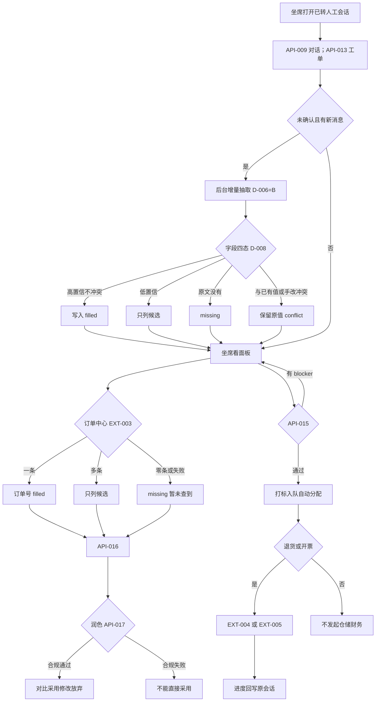
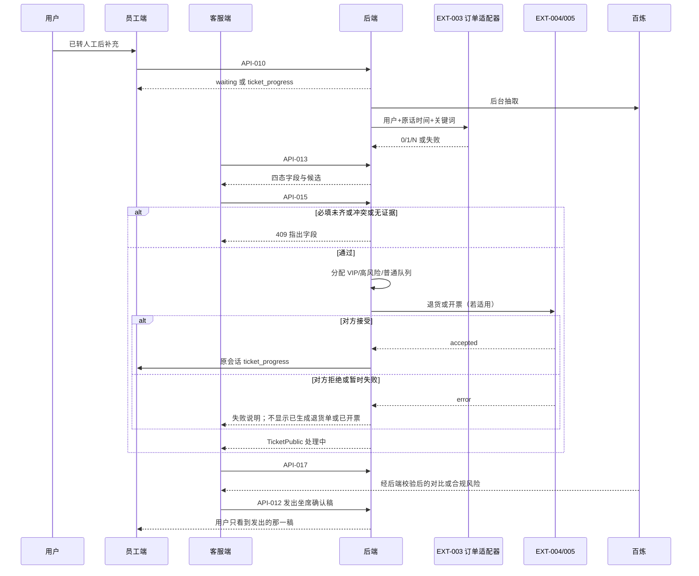
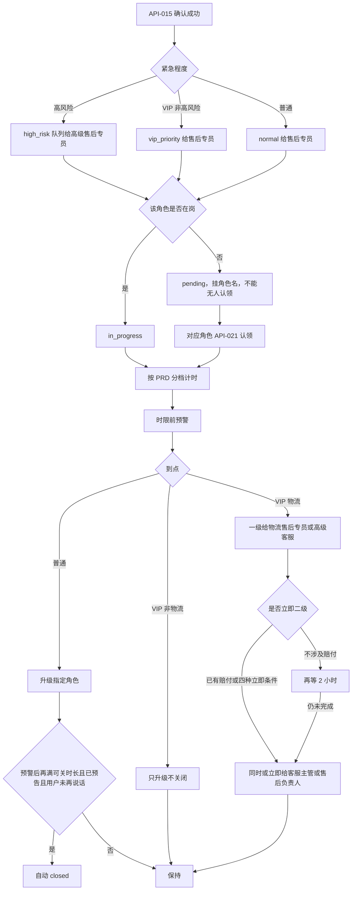

# 智能客服系统 · 七层技术方案

status: Confirmed  

> 2026-09-23：用户已要求定稿后直接开发。本方案无未决体验取舍，按该授权确认为实施契约。D-010 的检索权重与告警阈值不重开。
specification: default  
project_id: Customer_Service  
日期：2026-09-12；本轮改写：2026-09-23（按已确认 PRD REQ-001～REQ-011 重写受影响章节）

本方案覆盖已确认 PRD 的 REQ-001 至 REQ-011。标签体系以 `docs/tag-taxonomy.json` **v2.0（电商）** 为准。D-001～D-007 仍有效（D-006=B 后台抽取，D-007=A 确认后只手改）；D-006 中「后说覆盖先说」已由 PRD AC-032 替代，见 D-008。API-001～API-012 的 Method/URL 与成功失败语义不变，仅按已确认身份与工单进度做加法字段。API-013～017 按确认后的增量填单、知识溯源、合规润色重写，不再沿用旧四类工单 / `extracted|incomplete` 契约。外部订单中心、仓储、财务、会员、物流轨迹以可替换适配器表达，本轮不假装已有真实凭证。

---

## 一、用户要完成什么

引用 PRD《用户目标与完整流程》《需求与验收》《流程图与时序图》《界面约定》。业务规则、时效数字与升级对象以 PRD 为准，此处只对应入口与数据链路。产品数字不得在实现中改写。

| 需求 | 验收 | 入口 | 用户输入 → 系统处理 → 用户结果 |
| --- | --- | --- | --- |
| REQ-004 | AC-009、AC-010、AC-025、AC-026、AC-061 | `/login` | 按被允许身份登录 → 进入对应页面，顶栏显示用户名与退出；错误留在登录页；坐席打不开模板配置与灰度发布 |
| REQ-002 | AC-003、AC-004、AC-017、AC-018、AC-023、AC-024、AC-027～AC-029、AC-053、AC-059、AC-060 | `/knowledge` | 上传 md/txt/可抽出文字的 pdf → 入库中 → 转 Markdown 后分块打标写向量抽 FAQ → 完成后可改标签、FAQ、可见范围与政策生效时间；用户侧只召回「用户可见」 |
| REQ-001 | AC-001、AC-002、AC-011～AC-016、AC-019～AC-022、AC-075、AC-085（未转人工只走兜底分支） | `/employee` | 未转人工发消息 → 改写分类写入会话 → 反问最多 5 轮或满轮兜底 → FAQ / 闲聊 / 仅用户可见且标签匹配的知识回答；已有工单进度按回写状态回答；单纯查实时位置/库存/支付走固定兜底 |
| REQ-003 | AC-005～AC-008 | `/employee`、`/agent` | 员工点转人工 → 客服看到完整对话（含改写）并回复；此后除工单进度询问外不再进 FAQ/AI |
| REQ-005 | AC-030～AC-034、AC-043～AC-047、AC-057、AC-058、AC-083、AC-085 | `/agent` | 已转人工后增量填单：高置信写入、低置信只列候选、缺失与冲突分开；订单号走订单中心匹配；确认时挡住低置信/缺失必填/未解决冲突 |
| REQ-006 | AC-035～AC-037、AC-048、AC-049 | `/agent` | 坐席侧推送/搜索：主答案、摘要、来源、生效时间、适用品类；过期或未填生效时间的政策不作当前依据 |
| REQ-007 | AC-038～AC-040、AC-050、AC-051 | `/agent` | 润色只改表达；合规失败不能直接采用；高风险、费用争议、物流异常不能自动承诺赔付 |
| REQ-008 | AC-041、AC-042、AC-052、AC-062 | `/agent` | 按业务线、工单类型、场景（售前/售后/行程中）选用已发布模板；坐席只能反馈，不能改核心模板 |
| REQ-009 | AC-063～AC-066 | `/templates` | 管理端维护版本、约 5% 灰度、回滚、不少于 5000 条评测与拦截率告警 |
| REQ-010 | AC-067～AC-069、AC-076～AC-081、AC-088、AC-089 | `/tickets`、`/agent` | 确认后自动分配为主、认领为辅；VIP 单独队列；高风险只给高级售后专员；时效/预警/升级/关闭按 PRD 分档 |
| REQ-011 | AC-070、AC-071、AC-075 | `/tickets`、`/employee` | 退货联动仓储、开票联动财务；失败不显示已生成退货单或已开票；进度回写原会话 |

原型仍为登录、员工端、客服端、知识库；管理端模板与工单列表本轮按 PRD 界面约定新增页面，不在本文件改 HTML。视觉取值见 `docs/ui-style.md`。字段高置信/低置信/缺失/冲突的色值留给阶段 B 写入风格文档（PRD 已要求绿/黄/红区分）。

**完整数据链路**

1. 启动时按角色种子账号补齐 `users.role`（见 §三）；仍为 `ingesting` 且超过 `INGEST_STALE_SECONDS` 的文档标为 `failed`；仍为 `extracting` 过期的工单标 `extract_status=failed`。
2. 登录成功后前端持有 JWT；`SessionPublic.role` 决定可进页面。三个业务入口不再对所有身份开放。
3. 员工端：`sessionStorage` 已有有效 `conversation_id` 则拉 API-009 续聊，否则 API-007 新建（D-001=A）。
4. 知识入库仍按 D-002=B：校验通过立刻 `ingesting`，后台转 Markdown → 分块（800 字、重叠 160 字）→ 打标/向量/抽 FAQ。`ready` 后可改标签、FAQ、`visibility`、政策生效起止。未转人工召回只使用 `visibility=user_visible` 且可作为当前依据的文档。
5. 未转人工发消息：改写+分类 → 记原问与改写 → **不写 tickets**。问已有工单进度则按本会话已确认工单的最新回写回答（AC-075）。其余仍走 FAQ / 闲聊 / 用户可见知识 / 固定兜底。`requires_live_data`（单纯查现在到哪、库存、支付）不调工具。
6. 转人工后员工消息默认只落库并等待客服（API-010 已转人工分支的 HTTP 成功失败不变）；**工单进度询问例外**返回 `kind=ticket_progress`。客服发出仍只走 API-012。约 3 秒拉取（D-003=A）。
7. 已转人工填单：转接时建空草稿。未确认草稿在新员工消息或改类型后按 D-006=B 后台增量抽取。合并规则见 D-008：高置信且不冲突才写入；低置信只做候选；缺失保持空；冲突保留原值；坐席手改不被后续抽取覆盖。订单号经 EXT-003：一条自动填，多条只列候选，零条或失败标缺失且不编造。确认走 API-015，必填齐、无低置信未采纳、无未解决冲突才成功；确认后停止自动改字段，不能改工单类型（D-007=A）。
8. 确认成功：生成工单号，打紧急程度，VIP 进单独优先队列，高风险只分给高级售后专员，其余按队列分给售后专员；分配成功后为处理中。对应角色可认领未接起工单。一线坐席不能认领。
9. 退换货确认后调 EXT-004；开发票确认后调 EXT-005。对方未接住时坐席看到失败说明，工单不显示已生成退货单或已开票。状态变化向原会话写入用户可见进度。
10. 坐席知识推送/搜索走 API-016，可含仅坐席可见与高风险仅人工，不写 `messages`。润色走 API-017，合规失败 `can_adopt=false`。模板选用、灰度与评测走 API-024～033。

---

## 二、前后端怎么分工，接口怎么拆

### 分工与栈

| 端 | 职责 | 选型（default 白名单） |
| --- | --- | --- |
| 前端 | 登录与按角色进入的页面；员工端问答/转人工/看进度；客服端会话、四态填单、知识、润色、当次反馈；知识库上传与可见范围/生效时间；管理端模板与工单列表。组件内不直接发 HTTP。 | React + TypeScript + Vite + React Router；Axios 单例；Hooks / Context |
| 后端 | 鉴权与角色分权、入库、问答状态机、工单槽位、分配升级关单、模板灰度、评测告警。LLM/向量集中在百炼集成层。订单/仓储/财务/会员/物流走可替换适配器，缺地址时用进程内 Mock。 | Python 3.11+、FastAPI、pycore、SQLAlchemy + aiosqlite |
| 外部 | 百炼 Chat/Embedding。未转人工仍不向模型开放工具。确认后的联动不是模型工具，是后端适配器。 | `httpx.AsyncClient(trust_env=False)`，禁止 `dashscope` SDK |

- 后端基础 URL：进程内 `http://127.0.0.1:<port>`；前端 `VITE_API_BASE_URL=/api`，经 Vite 代理，禁止把完整后端 URL 写进业务代码。
- 鉴权：除登录外均 `Depends(get_current_user)`，`Authorization: Bearer <jwt>`。角色分权用 `require_roles(...)`，无权限返回 403 `FORBIDDEN`（本轮启用，不再写「本项目不使用 403」）。
- 统一 JSON 信封：`success`、`data`、`error`、`error_code`、`message`、`timestamp`、`request_id`、`metadata`。分页另含 `pagination`。
- 资源词：`sessions`、`documents`、`conversations`、`tickets`、`prompt-templates`、`evaluation-sets`、`workspace-settings`。转人工、发消息、回复、润色、知识推送、认领、灰度、回滚是所属资源上的动作。

### 身份与页面

`role` 取值（PRD 十类身份，一类一个 code，不把「或」拆成两个账号体系）：

| role | 身份 | 默认可进 |
| --- | --- | --- |
| `employee` | 员工 | `/employee` |
| `frontline_agent` | 一线坐席 | `/agent` |
| `after_sales_specialist` | 售后专员 | `/tickets`（普通/VIP 优先队列） |
| `senior_after_sales` | 高级售后专员 | `/tickets`（含高风险） |
| `supervisor` | 主管 | `/tickets`（升级与降级审批） |
| `after_sales_supervisor` | 售后主管 | `/tickets` |
| `cs_lead` | 客服负责人 | `/tickets` |
| `logistics_after_sales` | 物流售后专员或高级客服 | `/tickets`（VIP 物流一级） |
| `cs_supervisor` | 客服主管或售后负责人 | `/tickets`（VIP 物流二级） |
| `admin` | 管理端 | `/knowledge`、`/templates`、`/tickets`、设置 |

一线坐席可开已转人工会话并填单、润色、当次反馈，**不能**改模板、发布灰度、认领处理队列中的工单。管理端不能被坐席打开配置。员工不能开客服/管理页。知识库维护按管理身份；坐席只读推送，不进知识库配置。

### 接口索引

| 编号 | Method / URL | 说明 | 关联 |
| --- | --- | --- | --- |
| API-001 | POST /api/sessions | 登录（加法：`role`） | REQ-004 |
| API-002 | GET /api/sessions/current | 恢复登录态（加法：`role`） | REQ-004 |
| API-003 | POST /api/documents | 上传并受理后台入库 | REQ-002 |
| API-004 | GET /api/documents | 文档列表 | REQ-002 |
| API-005 | GET /api/documents/{document_id} | 详情（加法：可见范围与生效时间） | REQ-002 |
| API-006 | PATCH /api/documents/{document_id} | 仅 `ready` 保存标签/FAQ/可见范围/生效时间 | REQ-002 |
| API-007 | POST /api/conversations | 创建员工会话 | REQ-001、REQ-003 |
| API-008 | GET /api/conversations | 已转人工会话列表 | REQ-003 |
| API-009 | GET /api/conversations/{conversation_id} | 会话详情 | REQ-001、REQ-003、REQ-011 |
| API-010 | POST /api/conversations/{conversation_id}/messages | 员工发消息（加法：`ticket_progress`） | REQ-001、REQ-003、REQ-011 |
| API-011 | POST /api/conversations/{conversation_id}/transfer | 员工点转人工 | REQ-003 |
| API-012 | POST /api/conversations/{conversation_id}/replies | 客服发出回复 | REQ-003、REQ-007 |
| API-013 | GET /api/conversations/{conversation_id}/ticket | 读草稿或已确认工单 | REQ-005 |
| API-014 | PATCH /api/conversations/{conversation_id}/ticket | 坐席改类型/业务线/字段 | REQ-005、REQ-008 |
| API-015 | POST /api/conversations/{conversation_id}/ticket/confirm | 确认并自动分配 | REQ-005、REQ-010、REQ-011 |
| API-016 | GET /api/conversations/{conversation_id}/knowledge-suggestions | 坐席推送/搜索 | REQ-006、REQ-008 |
| API-017 | POST /api/conversations/{conversation_id}/replies/polish | 润色预览（含合规） | REQ-007、REQ-008 |
| API-018 | POST /api/conversations/{conversation_id}/ticket/attachments | 费用争议证据截图 | REQ-005 / AC-083 |
| API-019 | POST /api/conversations/{conversation_id}/result-feedbacks | 坐席当次结果反馈 | REQ-008 / AC-062 |
| API-020 | GET /api/tickets | 工单列表与检索 | REQ-010 |
| API-021 | POST /api/tickets/{ticket_id}/claim | 主动认领 | REQ-010 |
| API-022 | PATCH /api/tickets/{ticket_id} | 挂起/完成/关闭/上调紧急程度 | REQ-010 |
| API-023 | POST /api/tickets/{ticket_id}/urgency-approvals | 主管同意高风险降级 | REQ-010 / AC-077 |
| API-024 | GET /api/prompt-templates | 模板列表 | REQ-009 |
| API-025 | GET /api/prompt-templates/{template_id} | 模板正文（管理端） | REQ-009、REQ-008 |
| API-026 | PATCH /api/prompt-templates/{template_id} | 保存为新版本 | REQ-009 / AC-063 |
| API-027 | POST /api/prompt-templates/{template_id}/preview | 占位预览，不发回复 | REQ-009 / AC-064 |
| API-028 | GET /api/prompt-templates/{template_id}/versions | 版本记录与对比 | REQ-009 / AC-063 |
| API-029 | POST /api/prompt-templates/{template_id}/releases | 约 5% 灰度 | REQ-009 / AC-065 |
| API-030 | POST /api/prompt-templates/{template_id}/rollback | 回滚到上一稳定版 | REQ-009 / AC-065 |
| API-031 | GET /api/prompt-templates/{template_id}/metrics | 采纳/修改/投诉/拦截 | REQ-009 |
| API-032 | POST /api/evaluation-sets | 导入评测集 | REQ-009 / AC-065 |
| API-032a | GET /api/evaluation-sets/current | 当前评测集条数（最近一次导入） | REQ-009 / AC-065 |
| API-033 | GET /api/prompt-template-alerts | 合规拦截率告警 | REQ-009 / AC-066 |
| API-034 | GET /api/workspace-settings | 读大额订单金额线 | REQ-010 |
| API-035 | PATCH /api/workspace-settings | 写大额订单金额线 | REQ-010 |
| EXT-001 | POST {LLM_BASE_URL}/chat/completions | 百炼对话 | §四 |
| EXT-002 | POST {LLM_BASE_URL}/embeddings | 百炼向量 | §四 |
| EXT-003 | 订单中心适配器 | 按用户+时间+商品关键词匹配订单 | REQ-005 |
| EXT-004 | 仓储适配器 | 发起退货 | REQ-011 |
| EXT-005 | 财务适配器 | 发起开票 | REQ-011 |
| EXT-006 | 会员适配器 | 会员等级/消费/投诉/退款史 | REQ-010 |
| EXT-007 | 物流轨迹适配器 | 轨迹与签收状态 | REQ-005 / AC-085 |

无独立登出接口：前端丢弃 JWT。已登录时 API-002 的 `username`/`role` 用于顶栏与导航（AC-025、AC-026、AC-061）。

成功时 `data` 为载荷，`error` / `error_code` 为 `null`。失败时 `data` 为 `null`。失败处理见 §六。

---

### API-001 登录

| 项目 | 内容 |
| --- | --- |
| 关联需求 | REQ-004；AC-009、AC-010 |
| Method / URL | POST /api/sessions |
| 请求 | JSON `SessionCreate`：`username`、`password` 必填。无需 Token。 |
| 成功响应 | HTTP 200。`data`: `SessionPublic`：`access_token`、`token_type`=`bearer`、`username`、**`role`** |
| 失败响应 | 400 `VALIDATION_ERROR`；401 `UNAUTHORIZED`（用户名或密码错误，不区分哪一项） |

密码不回传。`role` 为本轮加法字段，不改变 200/400/401 语义。

成功示例：`data` 为 `{ "access_token": "<jwt>", "token_type": "bearer", "username": "employee", "role": "employee" }`。  
失败示例（错误密码，HTTP 401）：`error` 为「用户名或密码错误」，`error_code` 为 `UNAUTHORIZED`。

---

### API-002 恢复登录态

| 项目 | 内容 |
| --- | --- |
| 关联需求 | REQ-004；AC-009、AC-025、AC-026、AC-061 |
| Method / URL | GET /api/sessions/current |
| 请求 | 无 Body。`Authorization: Bearer <jwt>` |
| 成功响应 | HTTP 200。`data`: `{ "username": string, "role": role }` |
| 失败响应 | 401 `UNAUTHORIZED`（缺 Token、过期或无效），`error`：「请先登录」 |

本请求同时刷新「在岗」心跳（见 §五）。不改变 200/401 语义。

---

### API-003 上传并受理后台入库

| 项目 | 内容 |
| --- | --- |
| 关联需求 | REQ-002；AC-003、AC-004、AC-023、AC-029 |
| Method / URL | POST /api/documents |
| 请求 | `multipart/form-data`，字段 `file`；扩展名 `.md` / `.txt` / `.pdf`。Bearer。只校验并受理，不等待打标完成（D-002=B）。仅 `admin`。 |
| 成功响应 | HTTP 202。`data`: `DocumentPublic`，`ingest_status=ingesting`；标签/FAQ/chunks 空，`chunk_count=0`。可见范围此时可为空，完成后默认 `user_visible`。 |
| 失败响应 | 400 `VALIDATION_ERROR`，`error` 固定「请重新上传」，**不建文档行**；401；403；500 |

请求期校验、转 Markdown 规则、后台失败表现与上一版契约相同，见既有 AC-004/AC-029。本接口成功失败语义不变。

---

### API-004 文档列表

| 项目 | 内容 |
| --- | --- |
| 关联需求 | REQ-002；AC-003、AC-004、AC-023、AC-027、AC-028 |
| Method / URL | GET /api/documents?page=1&page_size=20（可选 `&ingest_status=`） |
| 请求 | Query：`page`≥1 默认 1；`page_size` 1～100 默认 20；`ingest_status` 可选 `ingesting` \| `ready` \| `failed`。仅 `admin`。 |
| 成功响应 | HTTP 200 分页。`data`: `DocumentListItem[]`（加法可含 `visibility`、`effective_from`、`effective_to`；无 chunks 正文） |
| 失败响应 | 400（分页或状态非法）；401；403 |

筛选映射、筛空文案、上传后切到「全部」的前端规则不变。成功失败语义不变。

---

### API-005 文档详情

| 项目 | 内容 |
| --- | --- |
| 关联需求 | REQ-002；AC-003、AC-017、AC-018、AC-024、AC-053、AC-059、AC-060 |
| Method / URL | GET /api/documents/{document_id} |
| 请求 | Path：`document_id`。Bearer。`admin` 可读写维护；坐席角色只读（为推送核对，不提供编辑页）。 |
| 成功响应 | HTTP 200。`data`: `DocumentPublic`。`ready` 含分块预览、标签、FAQ、**`visibility`、`effective_from`、`effective_to`**。不含 embedding。 |
| 失败响应 | 401；403；404 `NOT_FOUND`（「文档不存在」） |

分块预览只读（D-005）。加法字段不改变 200/401/404 语义。

---

### API-006 修改标签、FAQ、可见范围与生效时间

| 项目 | 内容 |
| --- | --- |
| 关联需求 | REQ-002；AC-017、AC-018、AC-053、AC-059、AC-060 |
| Method / URL | PATCH /api/documents/{document_id} |
| 请求 | JSON `DocumentUpdate`：`object_types`、`request_types`、`entities`、`faqs`、`visibility`、`effective_from`、`effective_to` 均可选；出现的字段整段替换。仅 `admin`。不含 `chunks`。 |
| 成功响应 | HTTP 200。`data`: 已是新内容的 `DocumentPublic`。分块正文与切法不变。 |
| 失败响应 | 400（非法 code、FAQ 空、可见范围非法、结束早于开始）；401；403；404；409（不是 `ready`） |

`visibility`：`user_visible` \| `agent_only` \| `high_risk_human_only`。两个时间可同时置 `null` 表示清空（AC-053）。清空后该文档不能再被坐席当作当前政策依据。改标签/FAQ 立即对后续提问生效。409 文案：入库中「文档仍在入库中，完成后才能修改标签或 FAQ。」；失败「请重新上传」。

---

### API-007 / API-008 / API-009

Method/URL 与成功失败语义不变。

- API-007 `POST /api/conversations`：无 Body；200 `ConversationPublic`（`status=bot`）；401。仅 `employee` 创建。D-001=A。
- API-008 `GET /api/conversations`：只返回 `handed_off`；200 分页；400/401。客服与处理角色可看。
- API-009 `GET /api/conversations/{id}`：200 含改写记录与后续进度消息；401/404。员工只能读自己的会话。

`ConversationPublic` 本轮仍不内嵌工单；工单走 API-013 / API-020。进度说明以 `kind=ticket_progress` 的系统消息出现在 `messages`（AC-071、AC-075）。

---

### API-010 员工发消息

| 项目 | 内容 |
| --- | --- |
| 关联需求 | REQ-001、REQ-003、REQ-011；AC-001、AC-002、AC-006、AC-007、AC-011～AC-016、AC-019～AC-022、AC-075 |
| Method / URL | POST /api/conversations/{conversation_id}/messages |
| 请求 | JSON `MessageCreate`：`content` 去空白后 1～4000 字。Bearer。 |
| 成功响应 | HTTP 200。`data`: `{ "conversation": ConversationPublic, "reply": MessagePublic }` |
| 失败响应 | 400 空内容；401；403；404；502/500（模型不可用，**不用**超范围兜底原文冒充） |

始终同步返回一条完整回复，不使用 SSE。成功失败语义与上一版相同。

`reply.kind`：`clarification` \| `faq` \| `small_talk` \| `knowledge` \| `fallback` \| `waiting_for_agent` \| **`ticket_progress`**。

未转人工固定兜底原文（AC-014）仍是：

`抱歉，这个问题我暂时无法根据现有知识准确回答。你可以换个说法再问，或点击转人工。`

已转人工默认 `kind=waiting_for_agent`，**不得**调用 FAQ/LLM。例外：本轮判定为询问本会话已有工单进度时，返回 `kind=ticket_progress`，正文只陈述工单已回写内容；没有该工单或没有对应进度时，正文为「目前没有可查询的工单进度。」，不编造到账或物流位置（AC-075）。此例外不改变本接口 200/4xx/5xx 划分。

仅文字提到「转人工」而未调 API-011，不得改 `status`（AC-007）。未转人工不创建工单。用户侧知识与 FAQ 只使用 `visibility=user_visible`。

---

### API-011 转人工

| 项目 | 内容 |
| --- | --- |
| 关联需求 | REQ-003；AC-005～AC-008 |
| Method / URL | POST /api/conversations/{conversation_id}/transfer |
| 请求 | 无 Body。只由员工端按钮触发。 |
| 成功响应 | HTTP 200。`data`: `ConversationPublic`（`status=handed_off`）。已是该状态则幂等返回。 |
| 失败响应 | 401；404 |

响应体不变。副作用：若无 `tickets` 行则插入空草稿。不经模型识别意图。

---

### API-012 客服回复

| 项目 | 内容 |
| --- | --- |
| 关联需求 | REQ-003、REQ-007；AC-005、AC-008、AC-038、AC-040 |
| Method / URL | POST /api/conversations/{conversation_id}/replies |
| 请求 | JSON `AgentReplyCreate`：`content` 1～4000 字。 |
| 成功响应 | HTTP 200。`data`: `{ "conversation", "reply" }`，`reply.role=agent`，`kind=agent` |
| 失败响应 | 400；401；404；409（会话未转人工） |

只把请求体 `content` 写成客服消息。润色是 API-017，不代替本接口。知识推送不得自动填入 `content`。成功失败语义不变。

---

### API-013 读取工单

| 项目 | 内容 |
| --- | --- |
| 关联需求 | REQ-005；AC-030～AC-034、AC-043、AC-044、AC-057、AC-058、AC-083、AC-085 |
| Method / URL | GET /api/conversations/{conversation_id}/ticket |
| 请求 | 无 Body。一线坐席及处理/管理角色。 |
| 成功响应 | HTTP 200。`data`: `TicketPublic`。已转人工且无行时创建空草稿再返回。**不**同步等待抽取或订单中心。 |
| 失败响应 | 401；403；404（会话不存在）；409（`status=bot`，「会话尚未转人工，不能填单」） |

`fields` 只含当前类型键。售前 `ticket_type=null` 时仅公共字段。`order_match` 与 `logistics_snapshot` 见 §三。`extract_status=extracting` 时返回上一版字段。

成功示例（退换货草稿，订单中心只命中一条，HTTP 200）：

```json
{
  "success": true,
  "data": {
    "id": "tkt_01HZX",
    "ticket_no": null,
    "conversation_id": "c_01HZX",
    "status": "draft",
    "ticket_type": "return_exchange",
    "business_line": "apparel_beauty",
    "urgency": null,
    "queue": null,
    "assigned_role": null,
    "assigned_user_id": null,
    "assigned_display": null,
    "upgrade_undelivered": false,
    "extract_status": "ready",
    "extract_error": null,
    "can_confirm": false,
    "confirm_blockers": ["return_reason"],
    "fields": {
      "order_no": { "value": "JD20260922001", "status": "filled", "candidates": [], "conflict_value": null },
      "product_info": { "value": "蓝色手机", "status": "filled", "candidates": [], "conflict_value": null },
      "amount": { "value": null, "status": "missing", "candidates": [], "conflict_value": null },
      "intent_summary": { "value": "要退昨天买的蓝色手机", "status": "filled", "candidates": [], "conflict_value": null },
      "return_method": { "value": null, "status": "missing", "candidates": [], "conflict_value": null },
      "return_reason": { "value": null, "status": "missing", "candidates": [], "conflict_value": null },
      "quantity": { "value": null, "status": "missing", "candidates": [], "conflict_value": null }
    },
    "order_match": {
      "status": "auto_filled",
      "query_message": null,
      "time_range_text": "昨天",
      "keywords": ["蓝色", "手机"],
      "candidates": [{ "order_no": "JD20260922001", "title": "蓝色手机", "ordered_at": "2026-09-21T10:00:00.000000" }]
    },
    "logistics_snapshot": null,
    "attachments": [],
    "progress": [],
    "sla": null,
    "confirmed_at": null,
    "created_at": "2026-09-23T07:00:00.000000",
    "updated_at": "2026-09-23T07:01:00.000000"
  },
  "error": null,
  "error_code": null,
  "message": "ok",
  "timestamp": "2026-09-23T07:01:00.000000",
  "request_id": "req-013",
  "metadata": {}
}
```

订单中心两条时：`order_no.status=candidate`，`value=null`，`order_match.status=candidates`，两条都在 `candidates`，不能预选（AC-057）。零条或查询失败：`order_no.status=missing`，`order_match.status` 为 `missing` 或 `query_failed`，`query_message` 为「暂未查到」，不出现编造单号（AC-058）。

---

### API-014 编辑工单

| 项目 | 内容 |
| --- | --- |
| 关联需求 | REQ-005、REQ-008；AC-030～AC-032、AC-041、AC-043、AC-046、AC-047 |
| Method / URL | PATCH /api/conversations/{conversation_id}/ticket |
| 请求 | JSON `TicketUpdate`：`ticket_type`、`business_line`、`fields` 均可选。一线坐席在确认前可改类型；确认后禁止改类型。 |
| 成功响应 | HTTP 200。`data`: `TicketPublic`。改类型后 `fields` 换为该类型键，公共字段值保留。 |
| 失败响应 | 400（枚举非法或提交了当前类型没有的键）；401；403；404；409（未转人工；或已确认后改 `ticket_type`，「工单已确认，不能更改工单类型」；或轨迹未核实却手填物流责任方/补偿方案） |

`ticket_type`：`return_exchange` \| `address_change` \| `invoice` \| `complaint` \| `fee_dispute` \| `logistics_exception` \| null。  
`business_line`：`digital_3c` \| `apparel_beauty` \| null。仅手选，系统不自动锁定。  
`fields`：键为当前类型允许键，值为 `string \| null`。提交某键视为手改：有值 → `agent_edited`；`null` → `missing`。

物流异常的 `responsible_party`、`compensation_plan`：仅当 `logistics_snapshot.query_status=ok` 时允许手填为已填；轨迹失败时保持 `missing`，PATCH 这两键返回 409「物流轨迹暂未核实，不能填写责任方或补偿方案」。补偿方案不能由抽取自动写成赔付承诺。

改类型或草稿出现新消息时投递后台抽取，本响应的 `extract_status` 可为 `extracting`。

---

### API-015 确认工单

| 项目 | 内容 |
| --- | --- |
| 关联需求 | REQ-005、REQ-010、REQ-011；AC-030、AC-033、AC-043、AC-067、AC-076、AC-080、AC-083 |
| Method / URL | POST /api/conversations/{conversation_id}/ticket/confirm |
| 请求 | 无 Body。一线坐席。 |
| 成功响应 | HTTP 200。`data`: `TicketPublic`。`status` 在分配成功后为 `in_progress`，尚未分到人时为 `pending`；`ticket_no` 非空；`confirmed_at` 非空；`urgency`/`queue`/`assigned_role` 已写入。已确认再调用：幂等返回当前工单。 |
| 失败响应 | 401；403；404；409：未转人工；或类型不是六类之一（「请先选择售后工单类型」）；或未选业务线（「请先选择业务线」）；或存在低置信未采纳、缺失必填、未解决冲突（`error` 指出字段，`metadata.confirm_blockers` 为键列表）；或费用争议无证据截图（「费用争议需要证据截图」）；或专票无税号 |

未点确认则一直为 `draft`（AC-033）。售前不能确认，推送/润色/API-012 不受影响（AC-043）。确认**不**再允许「缺项也能确认」（旧契约作废）。确认后新消息不再自动改字段。

成功后副作用（不改变本接口 200 信封）：打紧急程度 → 入队 → 自动分配 → 退换货调 EXT-004、开发票调 EXT-005（异步，见 §五）。修改地址、投诉、费用争议、物流异常本轮不发起仓储/财务。

---

### API-016 坐席知识推送与搜索

| 项目 | 内容 |
| --- | --- |
| 关联需求 | REQ-006、REQ-008；AC-035～AC-037、AC-048、AC-049 |
| Method / URL | GET /api/conversations/{conversation_id}/knowledge-suggestions |
| 请求 | Query：`q` 可选。无 `q` 为自动推送；有 `q` 为坐席搜索。不接受用 Query 覆盖已保存的类型/业务线。 |
| 成功响应 | HTTP 200。`data`: `KnowledgeSuggestionPublic`。空时 `suggestions=[]`，`empty_message` 为「当前没有可推送的政策或流程」。**不写** `messages`。 |
| 失败响应 | 401；403；404；409 未转人工；502 嵌入不可用（不得编造条款） |

每条结果必须有：`main_answer`、`summary`、`source`（文档名+标题路径）、`effective_from`、`effective_to`、`applicable_category`、`visibility`。按融合分从高到低。过期或未填生效时间的政策不出现。3C 与服饰口径不混用。物流异常推送不得把用户单方描述写成已核实丢件或责任方。坐席结果可含 `agent_only` 与 `high_risk_human_only`，这些内容不得进入 API-012。

前端不要按 3 秒无差别轮询本接口；在打开会话、改类型/业务线、有新消息或主动搜索时请求。

---

### API-017 话术润色预览

| 项目 | 内容 |
| --- | --- |
| 关联需求 | REQ-007、REQ-008；AC-038～AC-040、AC-050、AC-051 |
| Method / URL | POST /api/conversations/{conversation_id}/replies/polish |
| 请求 | JSON `AgentPolishCreate`：`content` 1～4000 字。 |
| 成功响应 | HTTP 200。`data`: `AgentPolishPublic`：`original_content`、`polished_content`、`compliance_passed` bool、`can_adopt` bool、`risk_reasons` string[]。不写 `messages`。 |
| 失败响应 | 400 空内容；401；403；404；409 未转人工；502 模型不可用。失败时原稿仍在前端。 |

`compliance_passed=false` 时 `can_adopt` 必须为 false，坐席界面不能把润色稿直接采用；仍可展示风险说明与润色稿文本供参考。高风险工单、费用争议、物流异常若出现新的赔付金额或「一定退」类承诺，视为未通过。原稿或会话已有的时效、金额、政策名称必须保持一致（AC-050）。用户愤怒时不用轻快语气（AC-051）。发出仍走 API-012。

成功且通过示例：`compliance_passed=true`，`can_adopt=true`，`risk_reasons=[]`。  
成功但不合规示例（仍 HTTP 200）：`compliance_passed=false`，`can_adopt=false`，`risk_reasons` 含「润色稿新增了会话中不存在的赔付金额」。

---

### API-018 工单附件（证据截图）

| 项目 | 内容 |
| --- | --- |
| 关联需求 | REQ-005 / AC-083 |
| Method / URL | POST /api/conversations/{conversation_id}/ticket/attachments |
| 请求 | `multipart/form-data`，字段 `file`；扩展名 `.png` / `.jpg` / `.jpeg` / `.webp`；大小同 `MAX_UPLOAD_BYTES`。 |
| 成功响应 | HTTP 200。`data`: `TicketPublic`（`attachments` 已含新项）。 |
| 失败响应 | 400「请重新上传」；401；403；404；409 未转人工或已确认后不允许用本接口改证据以外的字段（已确认仍可补证据但不触发重抽） |

费用争议无附件时 API-015 必须 409。

---

### API-019 坐席当次反馈

| 项目 | 内容 |
| --- | --- |
| 关联需求 | REQ-008 / AC-062 |
| Method / URL | POST /api/conversations/{conversation_id}/result-feedbacks |
| 请求 | JSON：`rating` 为 `useful` \| `useless`；`comment` 可选 0～500 字；`target` 为 `extract` \| `knowledge` \| `polish`。 |
| 成功响应 | HTTP 200。`data`: `{ "id", "conversation_id", "template_id", "template_version", "rating", "comment", "created_at" }`。不改模板正文。 |
| 失败响应 | 400；401；403（员工）；404 |

管理端在模板指标与反馈列表中可见。坐席界面无保存模板入口。

---

### API-020 工单列表

| 项目 | 内容 |
| --- | --- |
| 关联需求 | REQ-010；AC-067、AC-068 |
| Method / URL | GET /api/tickets |
| 请求 | Query：`page`、`page_size`；可选 `ticket_type`、`status`、`urgency`、`order_no`、`user_query`、`ticket_no`、`time_from`、`time_to`、`queue`。员工 403。一线坐席可看自己会话产生的工单，不能当处理队列认领。 |
| 成功响应 | HTTP 200 分页。`data`: `TicketListItem[]`：`ticket_no`、`ticket_type`、`status`、`urgency`、`queue`、`order_no`、`assigned_display`、`upgrade_undelivered`、`confirmed_at`、`sla_due_at`。 |
| 失败响应 | 400；401；403 |

默认不返回 `draft`。VIP 与普通分 `queue`：`vip_priority`、`normal`、`high_risk`。列表按队列优先级再按确认时间。

---

### API-021 认领工单

| 项目 | 内容 |
| --- | --- |
| 关联需求 | REQ-010；AC-067 |
| Method / URL | POST /api/tickets/{ticket_id}/claim |
| 请求 | 无 Body。 |
| 成功响应 | HTTP 200。`data`: `TicketPublic`，`status=in_progress`，处理人为当前用户。 |
| 失败响应 | 401；403（一线坐席、员工、或不属于该队列的角色）；404；409（已有处理人、或售后专员认领高风险/把 VIP 领进普通队列） |

自动分配为主，认领只处理尚未接起（`pending` 或已挂角色但无人）的工单。售后专员不能把 VIP 队列工单留在普通队列。高级售后专员可认领高风险。

---

### API-022 处理工单状态与紧急程度上调

| 项目 | 内容 |
| --- | --- |
| 关联需求 | REQ-010；AC-069、AC-077 |
| Method / URL | PATCH /api/tickets/{ticket_id} |
| 请求 | JSON：`status` 可选 `on_hold` \| `completed` \| `closed`；`hold_reason` 在挂起时为 `wait_user` \| `wait_warehouse`；`urgency` 可选（一线坐席只允许上调）。不可改 `ticket_type`。 |
| 成功响应 | HTTP 200。`data`: `TicketPublic`。状态变化时向原会话写入一条 `ticket_progress`。 |
| 失败响应 | 400；401；403；404；409（已关闭再改回待处理；一线坐席下调高风险；VIP 工单请求自动关闭） |

一线坐席把普通调到 VIP 或高风险立即生效并改派（AC-077）。下调高风险必须走 API-023。用户确认已解决 → `closed`。已关闭不再回到 `pending`。挂起表示等用户补充或等仓储确认。

---

### API-023 主管同意高风险降级

| 项目 | 内容 |
| --- | --- |
| 关联需求 | REQ-010 / AC-077 |
| Method / URL | POST /api/tickets/{ticket_id}/urgency-approvals |
| 请求 | JSON：`approved` bool；`target_urgency` 为 `normal` \| `vip`。仅 `supervisor`。 |
| 成功响应 | HTTP 200。`data`: `TicketPublic`。`approved=true` 才改变紧急程度并按新队列改派。 |
| 失败响应 | 401；403；404；409（当前不是高风险） |

未同意前保持高风险。

---

### API-024～API-028 模板只读、保存、预览、版本

模板资源按业务线 × 工单类型 × 场景唯一。场景：`pre_sale` \| `after_sale` \| `in_transit`。未形成工单类型时用售前或行程中场景，不能确认工单（AC-052）。一线坐席调用 API-025/026/027/028/029/030 返回 403（AC-061）。

**API-024** `GET /api/prompt-templates`：200 列表（id、业务线、类型、场景、stable_version、gray_version、gray_percent）。401/403。

**API-025** `GET /api/prompt-templates/{template_id}`：200 含当前编辑正文与占位说明。401/403/404。坐席不得看正文。

**API-026** `PATCH /api/prompt-templates/{template_id}`：Body `{ "body": string, "change_summary": string }`。200 新版本（`version`、`editor`、`edited_at`、`change_summary`）。仅 `admin`。每次保存生成新版本，不直接覆盖稳定版。

**API-027** `POST /api/prompt-templates/{template_id}/preview`：Body `{ "sample_utterance": string }`。200 `{ "rendered_body": string }`，占位已换成测试说法中的情绪/订单/政策，**不**调用发出坐席回复的模型路径（AC-064）。401/403/404。

**API-028** `GET /api/prompt-templates/{template_id}/versions?from=&to=`：200 `{ "versions": [...], "diff": string | null }`。能看出正文差异（AC-063）。

---

### API-029 / API-030 灰度与回滚

**API-029** `POST /api/prompt-templates/{template_id}/releases`：Body `{ "version": int, "gray_percent": int }`。`gray_percent` 默认取配置 `TEMPLATE_GRAY_PERCENT=5`（约 5%）。200 `{ "template_id", "gray_version", "stable_version", "gray_percent" }`。

失败：401；403；404；409「没有不少于 5000 条的评测集，不能开始灰度」（AC-065）。

灰度会话用 `hash(conversation_id) % 100 < gray_percent` 绑定新版本，其余用稳定版；绑定结果写入会话，供指标拆分。回滚不依赖另一次发版。

**API-030** `POST /api/prompt-templates/{template_id}/rollback`：无 Body 或 `{ "to_version": int }`，默认上一稳定版。200 后**新打开的会话**立即使用回滚版本（AC-065）。进行中已绑定灰度的会话不中途换版。

---

### API-031 / API-032 / API-033 评测、指标、告警

**API-031** `GET /api/prompt-templates/{template_id}/metrics`：200 含抽取准确率、话术采纳率、合规拦截率、修改率、投诉率、回流问题摘要；灰度中区分新/旧版本。仅 `admin`。

**API-032** `POST /api/evaluation-sets`：`multipart` 字段 `file`（JSONL/CSV）。每行至少含场景与输入、期望槽位或标签。200 `{ "id", "item_count" }`。`item_count < 5000` 时集合可用作调试，但 API-029 仍 409。仅 `admin`。最近一次成功导入即为「当前评测集」。

**API-032a** `GET /api/evaluation-sets/current`：200 `{ "id": string | null, "item_count": int }`。无导入时 `id=null`、`item_count=0`。供管理端刷新后恢复灰度门禁状态。仅 `admin`（坐席 403）。

**API-033** `GET /api/prompt-template-alerts`：200 `{ "alerts": [{ "template_id", "metric": "compliance_intercept_rate", "message", "created_at" }] }`。阈值见 D-010：最近 30 分钟拦截率比前 24 小时基线升高至少 20 个百分点，且最近 30 分钟润色次数 ≥ 10。

---

### API-034 / API-035 工作区设置

**API-034** `GET /api/workspace-settings`：200 `{ "high_risk_amount_threshold": number | null }`。`admin` 与主管只读；未配置为 `null`。

**API-035** `PATCH /api/workspace-settings`：`{ "high_risk_amount_threshold": number | null }`。仅 `admin`。`null` 表示没配置金额线，不因金额单独升为高风险（PRD）。

---

### EXT-001 / EXT-002 百炼

与上一版相同，来源：[OpenAI 兼容 Chat](https://help.aliyun.com/zh/model-studio/qwen-api-via-openai-chat-completions)、[文本向量同步接口](https://help.aliyun.com/zh/model-studio/text-embedding-synchronous-api)。

- EXT-001：`POST {LLM_BASE_URL}/chat/completions`，默认 `https://dashscope.aliyuncs.com/compatible-mode/v1`，模型默认 `qwen-plus`。
- EXT-002：`POST {LLM_BASE_URL}/embeddings`，默认 `text-embedding-v4`，每批最多 10 条，维度 1024。

禁止 dashscope SDK；`httpx` 必须 `trust_env=False`。

---

### EXT-003～007 可替换业务适配器

本轮**没有**真实订单中心、仓储、财务、会员、物流凭证。适配器接口由本系统定义，实现分 `mock` / `http`。`*_BASE_URL` 为空则走 Mock。禁止把 Mock 成功写成已联调。失败时用户可见行为必须符合 PRD。

**EXT-003 订单中心** `match_orders(user_key, time_range, keywords) -> OrderCandidate[]`

- `time_range` 必须来自用户原话，不得改成另一段日期。
- 一条：工单订单号 `filled`。多条：只列候选，不预选。零条：`missing`。适配器超时/5xx：`query_failed`，说明「暂未查到」，不编造单号。

**EXT-004 仓储** `create_return(ticket) -> { accepted, external_ref, error }`  
接受：进度「已发起退货」。拒绝或暂时失败：坐席看到失败说明，**不**出现「已生成退货单」。

**EXT-005 财务** `create_invoice(ticket) -> { accepted, external_ref, error }`  
对称于开票；失败不出现「已开票」。

**EXT-006 会员** `lookup_member(user_key) -> { level, history_spend, order_value, complaint_count, malicious_refund }`  
查不到则不标 VIP，也不因金额单独升高等级（金额线另见设置）。

**EXT-007 物流轨迹** `track(tracking_no or order_no) -> { events, sign_status, query_status }`  
`query_status=ok|empty|failed`。用户说丢件但已签收：回答与工单说明同时写明用户说法和已签收，不把丢件当既成事实，不自动填责任方。查不到：责任方与补偿方案保持 `missing`。

HTTP 形态（仅当配置了 Base URL）：`POST {BASE}/match-orders` 等，请求响应字段与上列函数同名 snake_case；具体厂商协议未提供，不得凭空写成某云厂商正式 API。

---

## 三、接口请求数据的类型选型

### 传输与校验

除上传与附件外均为 JSON、snake_case、前后端同名。空字符串按缺值。时间 UTC ISO-8601，前端本地时区展示。JWT 存 `localStorage.access_token`；员工会话 id 存 `sessionStorage.conversation_id`（D-001=A）。

### 共享枚举

`role`：§二表。  
`visibility`：`user_visible` \| `agent_only` \| `high_risk_human_only`。  
`ticket_type`：`return_exchange` \| `address_change` \| `invoice` \| `complaint` \| `fee_dispute` \| `logistics_exception` \| null。  
`business_line`：`digital_3c` \| `apparel_beauty` \| null。  
`ticket_status`：`draft` \| `pending` \| `in_progress` \| `on_hold` \| `completed` \| `closed`。旧值 `confirmed` 不再作为存储态；确认成功后进入 `pending` 或 `in_progress`。  
`urgency`：`normal` \| `vip` \| `high_risk`。  
`queue`：`normal` \| `vip_priority` \| `high_risk`。  
`field_status`：`filled` \| `candidate` \| `missing` \| `conflict` \| `agent_edited`。  
`extract_status`：`idle` \| `extracting` \| `ready` \| `failed`。  
`logistics_exception_type`：`delay` \| `lost` \| `damaged` \| `wrong_or_missing` \| `refused` \| `address_exception`。  
`template_scene`：`pre_sale` \| `after_sale` \| `in_transit`。  
`ingest_status`：`ingesting` \| `ready` \| `failed`。

合法对象/诉求 code 仍为 v2.0。工单类型 `fee_dispute` 检索映射到对象 `complaint`；`logistics_exception` 映射到 `order_logistics`。本轮不改 `tag-taxonomy.json` 的 code 清单。

`EntityTag`、`FaqItem`、`ChunkPreview`、`MessagePublic` 主体不变。`MessagePublic.kind` 增加 `ticket_progress`。`DocumentPublic` / `DocumentListItem` 增加 `visibility`、`effective_from`、`effective_to`。`SessionPublic` 增加 `role`。`ConversationPublic` 增加可选 `employee_user_id`（内部匹配订单，不要求员工端展示）。

### 工单字段

`TicketField`：`value` string \| null；`status`；`candidates` `OrderOrValueCandidate[]`（低置信或订单多条）；`conflict_value` string \| null（新值，仅 `conflict`）。`value` 为 null 且无候选时 `status` 必须为 `missing`。金额、税号、电话、地址只用字符串，且只能来自会话原文、订单中心返回或坐席手填。

各类型 `fields` 键：

| ticket_type | 键 |
| --- | --- |
| null | `order_no`、`product_info`、`amount`、`intent_summary` |
| return_exchange | 公共 + `return_method`（`return_only` \| `exchange` \| `refund_only`）、`return_reason`、`quantity` |
| address_change | 公共 + `original_address`、`new_address`、`recipient_name`、`phone` |
| invoice | 公共 + `invoice_kind`（`plain` \| `vat_special`）、`invoice_title`、`tax_id`、`invoice_contact` |
| complaint | 公共 + `complaint_category`、`incident_summary`、`user_expectation`、`need_escalate` |
| fee_dispute | 公共 + `dispute_type`（`price_protect` \| `shipping_fee` \| `refund_amount`）、`claimed_amount`、`platform_amount`、`diff_reason` |
| logistics_exception | 公共 + `tracking_no`、`exception_type`、`responsible_party`（`courier` \| `warehouse` \| `platform`）、`user_request`、`compensation_plan` |

费用争议的证据在 `attachments`，不是 `fields` 键。`platform_amount` 只能来自订单中心已有核算，模型不得新编。

`TicketPublic`：§二 API-013 示例所列字段。`can_confirm` 为计算值：六类之一 + 已选业务线 + `status=draft` + 必填均为 `filled` 或 `agent_edited` + 无 `candidate` 占必填 + 无 `conflict` + 费用争议至少 1 个附件 + 专票税号已填。`sla` 在确认后出现：`due_at`、`warn_at`、`close_after`（VIP 为 null）、`level`。

`KnowledgeSuggestionItem`：`document_id`、`filename`、`heading_path`、`main_answer`、`summary`、`source`、`effective_from`、`effective_to`、`applicable_category`、`visibility`。不再只返回裸 `content` 作为唯一依据。

`AgentPolishPublic`：见 API-017。

### 时效档（只转录 PRD，禁止改数字）

处理时限从**确认成功**起算。下表写入配置 `sla_rules`，测试对照 PRD AC-078～AC-081、AC-088、AC-089。

**普通用户（可自动关闭，且关闭前必须已有用户可见关闭预告；预告后用户又说话或工单在等补充则不关）**

| 类型 | 处理时限 | 时限前预警 | 到点升级 | 预警后再过多久可关 |
| --- | --- | --- | --- | --- |
| 修改地址、开发票 | 2 小时 | 30 分钟 | 主管 | 24 小时 |
| 退换货 | 24 小时 | 4 小时 | 售后主管 | 48 小时 |
| 费用争议 | 24 小时 | 4 小时 | 高级售后专员 | 48 小时 |
| 投诉维权 | 48 小时 | 8 小时 | 客服负责人 | 72 小时 |
| 物流延迟、错发/漏发、拒收 | 24 小时 | 4 小时 | （普通物流按关闭规则，升级对象以实现挂到处理角色；数字以本表为准） | 24 小时 |
| 物流丢件、破损 | 48 小时 | 12 小时 | 同上 | 48 小时 |
| 物流地址异常 | 12 小时 | 2 小时 | 同上 | 12 小时 |

**VIP（不自动关闭；到点只升级。无人在岗则挂在该角色并 `upgrade_undelivered=true`，处理人展示不能变空）**

| 类型 | 处理时限 | 时限前预警 | 升级对象 |
| --- | --- | --- | --- |
| 修改地址、开发票 | 30 分钟 | 10 分钟 | 主管 |
| 退换货 | 4 小时 | 1 小时 | 售后主管 |
| 费用争议 | 2 小时 | 30 分钟 | 高级售后专员 |
| 投诉维权 | 4 小时 | 1 小时 | 客服负责人 |
| 物流延迟、错发/漏发、拒收 | 12 小时 | 3 小时 | 一级：物流售后专员或高级客服 |
| 物流丢件、破损 | 24 小时 | 8 小时 | 同上 |
| 物流地址异常 | 6 小时 | 1.5 小时 | 同上 |

VIP 物流二级：已有赔付或补偿方案时，到点同时升到客服主管或售后负责人。不涉及赔付时，一级后再等 **2 小时**仍未完成再升二级。立即二级、不等这 2 小时：会话已威胁投诉/曝光/找消协；用户明确不接受一级方案；一级处理人表示权限不够或需主管审批；距离该单 VIP 处理时限已不足 2 小时。

地址异常不是「修改地址」工单，不套用 2 小时/30 分钟改地址档。

### 持久化（SQLite）

落点仍为 `backend/data/Customer_Service.db`。无跨会话记忆表。

在既有表上增加（实现阶段改模型，本轮只定契约）：

- `users.role` string；种子十个角色账号，密码只存哈希。
- `users.last_seen_at` 用于在岗。
- `documents.visibility`、`effective_from`、`effective_to`。
- `conversations.employee_user_id`、`template_bindings_json`。
- `tickets`：`ticket_no`、`urgency`、`queue`、`assigned_role`、`assigned_user_id`、`upgrade_undelivered`、`hold_reason`、`order_match_json`、`logistics_snapshot_json`、`sla_json`、`last_extracted_message_id`；`status` 用新枚举。
- 新表 `ticket_attachments`、`ticket_progress`、`result_feedbacks`、`prompt_templates`、`prompt_template_versions`、`prompt_template_releases`、`evaluation_sets`、`evaluation_items`、`template_alerts`、`workspace_settings`。

向量仍在进程内余弦，不另起向量库。会员/订单/仓储/财务/物流的外部主键只存在适配器返回快照里，本系统工单号不是外部单号。

### 跨请求生命周期

登录 JWT 默认 720 分钟。员工会话指针关标签页即丢，服务端记录保留。工单随会话保留，确认后进列表。润色稿只存在 API-017 响应。知识推送不落库。灰度绑定落在会话。适配器凭据只在 `.env` 字段名中出现，文档不写值。

---

## 四、模型选型与提示词设计

未转人工**禁止**向模型开放任何工具；实时位置/库存/支付只映射固定兜底。确认后的订单匹配、轨迹、仓储、财务由后端适配器执行，不通过 Plugin 层让模型自行调用。

| 用途 | 配置键 | 默认 | 依据 |
| --- | --- | --- | --- |
| 接入 | `LLM_BASE_URL`、`LLM_API_KEY` | 见 §七 | 百炼 OpenAI 兼容 |
| 对话 | `LLM_MODEL` | `qwen-plus` | 分类、打标、FAQ、改写、闲聊、知识回答、抽取、润色、模板预览占位渲染 |
| 向量 | `EMBEDDING_MODEL` | `text-embedding-v4` | 官方兼容接口 |
| 温度 | `LLM_TEMPERATURE` | `0.2` | 稳，少编造 |
| 超时 | `LLM_TIMEOUT_SECONDS` | `45` | |
| 重试 | `LLM_MAX_RETRIES` | `2` | 仅超时与 429 |

接入：`backend/src/integrations/bailian.py`，httpx。适配器：`backend/src/integrations/adapters/`。

| 文件 | 调用点 | 要点 | 输出 |
| --- | --- | --- | --- |
| `ingest_tag_faq.md` | 入库 | v2.0 code；3C/服饰不混 | JSON 标签+FAQ |
| `rewrite_classify.md` | API-010 未转人工 | 只用当前会话；不把查进度当成实时物流工具；禁止识别转人工动作 | JSON query_output；可多一个 `asks_ticket_progress` bool |
| `small_talk.md` | 闲聊 | 不承诺实时查询 | 纯文本 |
| `answer.md` | 知识回答 | 只用给定用户可见分块；多问题一条内分段 | 纯文本 |
| `ticket/extract_*.md` | 抽取 | 只摘原文；输出每键 `{value, confidence}`；不选定业务线；不编造金额税号电话地址订单号；费用争议不编核算金额；物流不把用户说法写成已核实责任方 | JSON |
| `ticket/line_*.md` | 拼进抽取/润色 | 3C 与服饰互斥 | 片段 |
| `ticket/polish.md` | API-017 | 只改表达；愤怒则克制；禁止新赔付/改价/一定退；高风险/费用争议/物流异常尤其禁止新赔付额 | 纯文本 |
| 管理端模板 body | 填单/推送/润色选用 | 占位：情绪、订单信息、政策条款 | 运行时代入后再调对应任务 |

`confidence`：`high` \| `low`。后端再校验：高置信必须能在会话原文或 EXT-003 返回中找到对应片段，否则降为 low 或丢弃。高置信阈值配置 `EXTRACT_HIGH_CONFIDENCE_MIN=0.8` 仅用于模型另给分数时的下限；无分数则只认枚举。

解析失败可做 1 次格式重试。对象标签为空则入库失败。FAQ 允许空数组。

分类 `processing_status` 仍为 `ready` / `needs_clarification` / `requires_live_data` / `out_of_scope`。已有工单进度走本地回写，不走 `requires_live_data`。

---

## 五、接口逻辑算法设计

跨接口：`get_current_user` + `require_roles`。标签体系读 `backend/src/resources/tag-taxonomy.json`（与 docs v2.0 同源）。在岗：`last_seen_at` 在 `ON_DUTY_SECONDS`（默认 300）内。SLA 扫描用进程内定时循环（默认 60 秒），不另引队列产品。

### 共用：召回（D-010）

只使用 `ingest_status=ready` 的文档。

1. 标签过滤：禁止全库无差别召回。`product_3c` 与 `product_fashion` 互斥（AC-013）。
2. 可见范围：未转人工只要 `user_visible`。坐席推送/搜索三者都可。
3. 当前依据：`request_types` 含 `policy_process` 或 `after_sale_howto` 的文档必须 `effective_from`/`effective_to` 都有值且当前时间落在闭区间内；缺日期或过期不进入推送/搜索，也不作为未转人工政策回答依据。
4. 融合分：`0.7 * cosine + 0.3 * keyword`（keyword 为查询词与 `heading_path+content` 的重叠率，0～1）。本轮**不**调用付费重排模型。FAQ 命中仍用余弦 `>= FAQ_HIT_THRESHOLD`（默认 0.82）。分块 Top `RETRIEVE_TOP_K`（5）且融合分 `>= RETRIEVE_MIN_SCORE`（0.55）。坐席 Top `AGENT_KNOWLEDGE_TOP_K`（3）。

无过阈结果 = 无可用知识 / 空推送文案。禁止用模型编造条款补空。

### API-001 / API-002

校验密码 → 签/解 JWT，写入 `role`。API-002 成功则更新 `last_seen_at`。无新的用户取舍。

### API-003～006

入库流水线与上一版相同（D-002=B、D-005）。API-006 额外写可见范围与生效时间，不重切。`ready` 且未写可见范围时默认 `user_visible`，避免旧文档突然从用户侧消失。

| 技术选择与触发场景 | 用户可见结果或代价 | 当前处理与依据 | 验收 |
| --- | --- | --- | --- |
| 标为仅坐席可见 | 员工端自动回答用不上；坐席推送能看见 | PRD AC-059 | 两篇文档对照两端 |
| 高风险仅人工 | 不自动发给用户 | AC-060 | 员工端提问 vs 坐席详情 |
| 未填或过期政策 | 不出现在当前依据 | AC-048 | 一前一后两篇生效时间 |

### API-007～009

不变。进度消息出现在详情中。

### API-010 状态机

```
保存员工消息(original)
若判定 asks_ticket_progress:
    读本会话已确认工单最新 progress
    有则原样陈述；无则「目前没有可查询的工单进度。」
    返回 kind=ticket_progress（已转人工也不走 waiting）
若 status=handed_off:
    不调用 FAQ/改写/检索（可按 §五投递抽取，不改变本响应）
    返回 waiting_for_agent
改写+分类（EXT-001，写入 rewritten）
    不得插入 tickets
若须反问且轮次 < 5: 反问
若须反问且已满 5: 固定兜底
否则重置 clarification_round
FAQ（只用户可见且可作依据的 FAQ）→ 闲聊 → 超范围/实时工具/无知识兜底
→ 标签内检索（只要用户可见）→ 一条分段 knowledge
```

| 技术选择与触发场景 | 用户可见结果或代价 | 当前处理与依据 | 验收 |
| --- | --- | --- | --- |
| 已转人工问退款到哪了 | 直接看到回写进度，不必等坐席先查 | PRD AC-075 | 有工单/无工单各问一次 |
| 未转人工只问包裹现在到哪 | 固定兜底，无编造位置 | AC-014 | 与物流异常工单路径区分 |
| 仅坐席可见文档 | 未转人工答不出来 | AC-059 | 改可见范围后立刻提问 |

### API-011 / API-012

转接幂等；建空草稿不改响应。API-012 只写 `content`。

### 共用：增量抽取与订单匹配（D-006=B，D-008）

仅 `status=draft`。售前不跑类型模板、不自动选定类型。已确认不抽取（D-007=A）。

GET（API-013）永不调模型或外部适配器同步等待。改类型或出现新员工消息：`extract_status=extracting` → EXT-001 JSON → 金额/税号/电话/地址必须能在原文找到 → EXT-003 匹配订单（时间范围取原话）→ 物流异常再调 EXT-007 → 合并 → `ready`/`failed`。

字段合并：

1. `agent_edited`：永不被抽取覆盖；新值与手改矛盾 → `conflict`，`value` 仍为手改，`conflict_value` 为新值。
2. 抽取 `high` 且与已有 `filled` 值不同 → `conflict`，保留原值（AC-032：99 不自动变 88）。
3. 抽取 `high` 且原为 `missing` 或不冲突 → 写入 `filled`。
4. 抽取 `low` → 不写 `value`，进入 `candidates`，字段 `candidate`（已有 `filled` 时保持原值并只附候选）。
5. 抽取空 → 保持 `missing` 或原 `filled`，不编造。
6. 订单号：EXT-003 一条 → `filled`；多条 → `candidate` 且全部列出；零条/失败 → `missing`。

后台失败保留合并前字段，坐席可手填（订单号允许手填；物流责任方在轨迹失败时不能手填，见 API-014）。

### API-013～015

读：未转人工 409；无行建草稿。  
改：已确认改类型 409。  
确认：校验 `can_confirm` → 写 `ticket_no`（`TKT-YYYYMMDD-XXXX`）→ 打标入队分配 → 异步联动。

**紧急程度（确认时计算，打标 ≠ 承诺赔付）**

1. 会话或历史出现投诉/消协/媒体/曝光，或情绪愤怒/威胁，或历史多次投诉/恶意退款，或同一用户连续三次投诉 → `high_risk`。
2. 否则 EXT-006 表明 VIP，或会员等级/历史消费/订单价值符合 VIP → `vip`。查不到会员数据则不标 VIP。
3. 管理端金额线已配置且订单金额达到该线 → `high_risk`；未配置不因金额单独升级。
4. 否则 `normal`。

**分配**

- `high_risk` → `queue=high_risk`，只分给在岗 `senior_after_sales`；高风险 VIP 排在普通高风险之前。
- 其余 `vip` → `queue=vip_priority`，分给在岗 `after_sales_specialist`，优先于普通队列。
- `normal` → `queue=normal`，分给在岗售后专员。
- 分到人：`in_progress`。无人：`pending`，`assigned_role` 仍为该角色，`assigned_display` 为角色名，`upgrade_undelivered` 在升级场景使用，处理人展示不能变空。

| 技术选择与触发场景 | 用户可见结果或代价 | 当前处理与依据 | 验收 |
| --- | --- | --- | --- |
| 昨天两笔蓝色手机 | 订单号不预选，两笔都列出 | PRD AC-057 | 面板无预选 |
| 订单中心失败 | 缺失 + 暂未查到，无编造单号 | AC-058 | 空结果与失败各一次 |
| 确认时仍有低置信或冲突 | 确认失败并指出字段 | 产品已锁定 | 与旧「缺项可确认」不同 |
| VIP 与普通同时待分配 | VIP 在优先队列 | AC-080 | 两条队列对照 |

### API-016 / API-017

推送按 §五召回 + 业务线过滤。搜索与推送同一结果形状（AC-049）。润色后做规则校验：抽出时效数字、金额、政策名与原稿/会话比对；再扫赔付/一定退/改价；命中则 `compliance_passed=false`。

### API-018～023

附件只存本地 `upload_dir/tickets/`。认领校验队列与角色。SLA 循环：到 `warn_at` 给当前处理人预警；到 `due_at` 升级到 PRD 角色的在岗者，否则 `upgrade_undelivered=true` 且 `assigned_display` 仍为该角色名。普通工单到可关时刻：原会话必须已有关闭预告；其后用户又发言或 `hold_reason=wait_user` 则跳过。VIP 永不自动关。VIP 物流二级规则按 §三，等待 2 小时，四种情况立即升。

自动关闭与升级写入 `ticket_progress` 并向原会话插 `kind=ticket_progress`。

### API-024～035

模板选用：确认前按手选业务线 + 类型 + 场景；未选业务线不加 3C/服饰专属片段。行程中 = 物流异常且未签收。灰度与评测见 §二。坐席反馈不改 `prompt_template_versions.body`。

### 用户流程图：转人工后填单到分配（已补接口编号）



### 技术时序：确认、联动与进度



源文本已按参与者与调用方向核对；本环境无可用 Mermaid 预览，仅完成源文本检查。未转人工入库与提问时序仍沿用 PRD 已有图，参与者为知识库页/员工端/后端/百炼/SQLite，API-003～012 编号不变。

### 用户流程图：确认后状态、升级与关闭



---

## 六、接口失败异常设计

共享错误码：`VALIDATION_ERROR` 400、`UNAUTHORIZED` 401、`FORBIDDEN` 403、`NOT_FOUND` 404、`CONFLICT` 409、`INTERNAL_ERROR` 500。模型/百炼不可用对前端用 HTTP 502，`error_code` 仍为 `INTERNAL_ERROR`，`error` 为「服务暂时不可用，请稍后重试。」不得用 AC-014 兜底原文冒充。面向用户的 `error` 用中文。日志不写密钥、密码、Token。适配器失败按业务结果处理，不把 Mock 成功报成真联调。

### API-001 / API-002

与上一版相同：缺字段 400；用户名或密码错 401「用户名或密码错误」；坏 Token 401「请先登录」。种子账号未初始化且配置缺密码 → 500。加法 `role` 不影响上述失败语义。

### API-003～006

提交期非法文件：400「请重新上传」，不建行。后台失败：`failed` +「请重新上传」，无 FAQ 无分块。非 `admin` → 403。API-006 非 `ready` → 409。可见范围或日期非法 → 400。FAQ 替换嵌入失败则回滚旧 FAQ。

### API-007～012

会话不存在 404。API-010 模型失败：502「服务暂时不可用，请稍后重试。」，已写入的员工原问保留；不用兜底原文冒充故障。已转人工默认等待客服；进度询问失败（读库异常）同样 502，不编造到账。API-012 未转人工 → 409「会话尚未转人工，无法以客服身份回复」。客户端断开：若服务端已落库，刷新 API-009 可见。前端超时禁止自动重发同一内容。

### API-013～015

| 触发 | HTTP / 码 | 用户提示 | 恢复 |
| --- | --- | --- | --- |
| 未转人工读/改/确认 | 409 | 会话尚未转人工，不能填单 | 员工先点转人工 |
| 非法类型/业务线/字段键 | 400 | 工单字段无效 | 按当前类型改请求 |
| 已确认后改类型 | 409 | 工单已确认，不能更改工单类型 | 只能手改其他字段 |
| 轨迹未核实填责任方/补偿 | 409 | 物流轨迹暂未核实，不能填写责任方或补偿方案 | 等轨迹或继续对话 |
| 未选六类/未选业务线 | 409 | 请先选择售后工单类型 / 请先选择业务线 | 先 PATCH |
| 低置信、缺失必填、冲突 | 409 | 指出具体字段 | 采纳候选、手填或解决冲突 |
| 费用争议无截图 | 409 | 费用争议需要证据截图 | API-018 |
| 专票无税号 | 409 | 专用发票需要纳税人识别号 | 手填 |
| EXT-003 失败 | GET 仍 200 | 订单号 missing + 暂未查到 | 手填或稍后重抽 |
| 抽取失败 | GET 200，`extract_status=failed` | 抽取暂时失败，请稍后重试或手填 | 不无限重试 |
| 确认重复 | 200 | 当前已确认工单 | 幂等 |

金额/税号/电话/地址被模型填出但不在原文 → 丢弃为 missing，不当系统错误。

### API-016 / API-017

未转人工 409。无过阈分块：200 空 suggestions。EXT-002 失败：502，不得编造政策。润色模型失败：502，原稿留在输入区，可直接 API-012。合规失败是 **200** 业务结果，不是 4xx。

### API-018～023

附件非法：400「请重新上传」。一线坐席认领：403。认领错队列或已有处理人：409。一线坐席下调高风险：409，保持高风险直到 API-023。VIP 请求自动关闭：409。已关闭改回待处理：409。仓储/财务失败：工单 200 路径上的进度为失败说明，不出现已生成退货单/已开票（AC-070）。升级无人在岗：不把处理人置空，标 `upgrade_undelivered`。

### API-024～035

非 `admin` 打开模板正文、保存、灰度、回滚、评测导入、改金额线：403（AC-061）。评测集不足 5000：API-029 为 409。灰度中回滚成功后新会话不用旧灰度版。告警接口失败不得假装没有升高。

### 适配器

| 适配器 | 失败时用户可见 | 禁止出现 |
| --- | --- | --- |
| EXT-003 | 订单号缺失，暂未查到 | 编造订单号、多条里预选 |
| EXT-004 | 坐席看到失败说明 | 「已生成退货单」 |
| EXT-005 | 坐席看到失败说明 | 「已开票」 |
| EXT-006 | 不标 VIP | 把查不到当成 VIP |
| EXT-007 | 责任方/补偿缺失，回复暂时不能判断 | 按用户说法写成已核实丢件 |

超时与 5xx：各适配器重试最多 2 次（仅超时/429），然后按上表降级。不无限重试付费或外部写操作；仓储/财务写请求用 `ticket_id` 幂等键，重复确认不建第二张外部意图（Mock 亦遵守）。

---

## 七、项目本地层级设计

```
Customer_Service/
├── pycore/                          # 框架，不改、不纳入质量门禁
├── docs/                            # PRD、tech-spec、decisions、tag-taxonomy
├── backend/
│   ├── .env / .env.example
│   ├── requirements.txt
│   ├── src/
│   │   ├── main.py
│   │   ├── api/deps.py              # get_current_user、require_roles、在岗心跳
│   │   ├── api/routes/
│   │   │   ├── sessions.py          # API-001、002
│   │   │   ├── documents.py         # API-003～006
│   │   │   ├── conversations.py     # API-007～012、016、017、019
│   │   │   ├── tickets.py           # API-013～015、018；会话下 ticket
│   │   │   ├── ticket_queue.py      # API-020～023；/api/tickets
│   │   │   ├── prompt_templates.py  # API-024～031、033
│   │   │   ├── evaluation_sets.py   # API-032
│   │   │   └── workspace_settings.py# API-034、035
│   │   ├── db/models.py
│   │   ├── services/                # ingest、qa、handoff、ticket、assign、sla、
│   │   │                            # agent_knowledge、polish、templates、compliance
│   │   ├── integrations/bailian.py
│   │   ├── integrations/adapters/   # order、warehouse、finance、member、logistics
│   │   ├── prompts/ticket/
│   │   └── resources/tag-taxonomy.json
│   ├── data/                        # db、uploads、ticket attachments
│   └── tests/
├── frontend/src/
│   ├── pages/                       # Login、Employee、Agent、Knowledge、
│   │                                # TicketList、TemplateAdmin、Settings
│   ├── components/、hooks/、stores/、services/、router/、types/
│   └── mocks/
└── pyproject.toml
```

目录与框架由本方案确定，不作为向用户重开的取舍。

### 运行环境

- Python 3.11+；`cd backend && PYTHONPATH=.. <python> -m uvicorn src.main:app --reload --host 127.0.0.1 --port 8099`
- 前端：`cd frontend && npm run dev -- --host 127.0.0.1 --port 5199`；用户门禁端口 5175，`VITE_BACKEND_PROXY_TARGET=http://localhost:8003`
- 后端验证 8099，门禁 8003。CORS 含 localhost/127.0.0.1 的 5199 与 5175
- `pytest backend/tests --timeout=120`；ruff/mypy 不扫 `pycore/`
- 依赖沿用上一版，另无需白名单外框架；PDF 仍用 `pypdf` 只抽可复制文字

### 配置表

后端由 pycore `ConfigManager.load(..., use_env=False)` 读取。文档只写字段名。

| 字段 | 类型 | 默认 | 用途 | 敏感 |
| --- | --- | --- | --- | --- |
| debug | bool | true | 日志 | 否 |
| secret_key | string | 无 | JWT | 是 |
| host / port | string / int | 127.0.0.1 / 8099 | 监听 | 否 |
| cors_origins | list | 四条 5199/5175 | CORS | 否 |
| database_path | string | data/Customer_Service.db | SQLite | 否 |
| upload_dir | string | data/uploads | 上传 | 否 |
| seed_password | string | 无 | 十个角色种子账号共用口令，只首次哈希 | 是 |
| jwt_expire_minutes | int | 720 | 登录有效期 | 否 |
| llm_api_key | string | 无 | 百炼 | 是 |
| llm_base_url | string | https://dashscope.aliyuncs.com/compatible-mode/v1 | Chat/Embedding | 否 |
| llm_model | string | qwen-plus | 对话 | 否 |
| llm_temperature | float | 0.2 | 采样 | 否 |
| llm_timeout_seconds | float | 45 | 超时 | 否 |
| llm_max_retries | int | 2 | 超时/429 | 否 |
| embedding_model | string | text-embedding-v4 | 向量 | 否 |
| embedding_dimensions | int | 1024 | 维 | 否 |
| embedding_batch_size | int | 10 | 每批上限 | 否 |
| max_upload_bytes | int | 5242880 | 上传上限 | 否 |
| chunk_max_chars | int | 800 | 分块 | 否 |
| chunk_overlap_chars | int | 160 | 重叠 20% | 否 |
| ingest_max_chars | int | 24000 | 打标输入 | 否 |
| context_message_limit | int | 20 | 会话条数 | 否 |
| faq_hit_threshold | float | 0.82 | FAQ | 否 |
| retrieve_top_k | int | 5 | 用户侧召回 | 否 |
| retrieve_min_score | float | 0.55 | 下限 | 否 |
| retrieve_cosine_weight | float | 0.7 | 融合 | 否 |
| retrieve_keyword_weight | float | 0.3 | 融合 | 否 |
| agent_knowledge_top_k | int | 3 | 坐席条数 | 否 |
| poll_interval_ms | int | 3000 | D-003 | 否 |
| ingest_stale_seconds | int | 300 | 入库/抽取过期 | 否 |
| fallback_reply | string | PRD 固定兜底 | 禁止另写一份 | 否 |
| clarification_max_rounds | int | 5 | 反问上限 | 否 |
| extract_high_confidence_min | float | 0.8 | 高置信下限 | 否 |
| on_duty_seconds | int | 300 | 在岗心跳 | 否 |
| sla_scan_seconds | int | 60 | SLA 扫描 | 否 |
| template_gray_percent | int | 5 | 约 5% 灰度 | 否 |
| eval_min_items | int | 5000 | 灰度门禁 | 否 |
| alert_intercept_delta | float | 0.20 | 拦截率升高 20 个百分点 | 否 |
| alert_intercept_min_n | int | 10 | 30 分钟内最少润色次数 | 否 |
| alert_window_minutes | int | 30 | 告警窗口 | 否 |
| order_center_base_url | string | 空 | 空则 Mock | 否 |
| warehouse_base_url | string | 空 | 空则 Mock | 否 |
| finance_base_url | string | 空 | 空则 Mock | 否 |
| member_base_url | string | 空 | 空则 Mock | 否 |
| logistics_base_url | string | 空 | 空则 Mock | 否 |

`sla_rules` 以 JSON 配置固化 §三表格，数字必须与 PRD 一致。前端：`VITE_API_BASE_URL=/api`，`VITE_BACKEND_PROXY_TARGET`，`VITE_POLL_INTERVAL_MS=3000`。

种子用户名（密码只来自 `seed_password`）：`employee`、`agent`、`specialist`、`senior`、`supervisor`、`after_sales_supervisor`、`cs_lead`、`logistics_agent`、`cs_supervisor`、`admin`，分别对应 §二的十个 `role`。已有旧共享账号补 `role=employee`，不删行。

### 外部服务清单

| 名称 | 用途 | 依赖 | 配置状态 | 模式 | 真实验证所需 |
| --- | --- | --- | --- | --- | --- |
| 阿里云百炼 Chat | 打标、改写、抽取、润色等 | EXT-001 | `llm_api_key` 需本地填 | 无 Key 则相关 AC 只能 Mock | 账号与额度 |
| 阿里云百炼 Embedding | 分块/FAQ/检索 | EXT-002 | 同上 | 同上 | 同上 |
| 订单中心适配器 | 订单号匹配 | EXT-003 | `order_center_base_url` 本轮空 | Mock | 真实凭证本轮没有 |
| 仓储适配器 | 退货 | EXT-004 | 空 | Mock | 无 |
| 财务适配器 | 开票 | EXT-005 | 空 | Mock | 无 |
| 会员适配器 | VIP/投诉史 | EXT-006 | 空 | Mock | 无 |
| 物流轨迹适配器 | 轨迹与签收 | EXT-007 | 空 | Mock | 无 |

无百炼 Key **不阻塞**登录、转人工、手填确认、认领、列表与模板配置页的开发；阻塞自动回答、抽取、推送、润色真实验证。无外部业务凭证 **不阻塞**按 Mock 验收「不编造订单号、不显示已生成退货单或已开票」。Mock 与真联调必须分开报告。

Axios 超时：API-003 15s；API-010/017 60s；API-016 30s；工单 GET/PATCH/确认 15s。客服端仅当 `extract_status=extracting` 时按 3 秒拉 API-013。

---

## 需求覆盖检查

| AC | 实现路径 |
| --- | --- |
| AC-009、AC-010、AC-025、AC-026、AC-061 | API-001/002 + 角色分权；坐席调模板 API 为 403 |
| AC-003、AC-004、AC-023、AC-024、AC-027～AC-029 | API-003～006，入库契约不变 |
| AC-017、AC-018、AC-053、AC-059、AC-060 | API-006 可见范围与生效时间 + API-010/016 过滤 |
| AC-001、AC-011～AC-016、AC-019～AC-022 | API-010；用户可见 + 标签过滤 |
| AC-002、AC-007 | 仅 API-011 转接 |
| AC-014、AC-015 | 实时位置/库存/支付 → 固定兜底，无工具 |
| AC-005、AC-006、AC-008 | API-008～012；AC-006 的进度例外见 AC-075 |
| AC-030～AC-034、AC-043～AC-047、AC-057、AC-058、AC-083、AC-085 | API-013～015、018；D-008；EXT-003/007 |
| AC-035～AC-037、AC-048、AC-049 | API-016 主答案/摘要/来源/生效/品类 |
| AC-038～AC-040、AC-050、AC-051 | API-017 合规门禁 + API-012 发出 |
| AC-041、AC-042、AC-052、AC-062 | 类型字段切换、模板选用、API-019 |
| AC-063～AC-066 | API-024～033 |
| AC-067～AC-069、AC-076～AC-081、AC-088、AC-089 | API-015、020～023、SLA 循环 |
| AC-070、AC-071、AC-075 | EXT-004/005 + 进度回写 + API-010 `ticket_progress` |

---

## 待确认事项

无未决的产品体验取舍。时效、升级对象、关闭规则、订单匹配、槽位四态、可见范围、角色与灰度评测门禁均已由 2026-09-23 确认 PRD 写死。检索融合权重与合规告警数值由本方案 D-010 定值，不重开给用户。D-001～D-007 沿用（D-006 仅合并规则改从 D-008）。缺百炼 Key 或外部业务凭证只影响相关真实验证，可用 Mock 推进独立工作。

PRD 中「转人工后填单」流程图仍写「接口编号等技术方案再次确认后补回」。本文件 §五已补齐 API 与适配器参与者。本轮按授权不改 `docs/PRD.md`；确认本方案后由主智能体回写 PRD 图中的接口编号。
